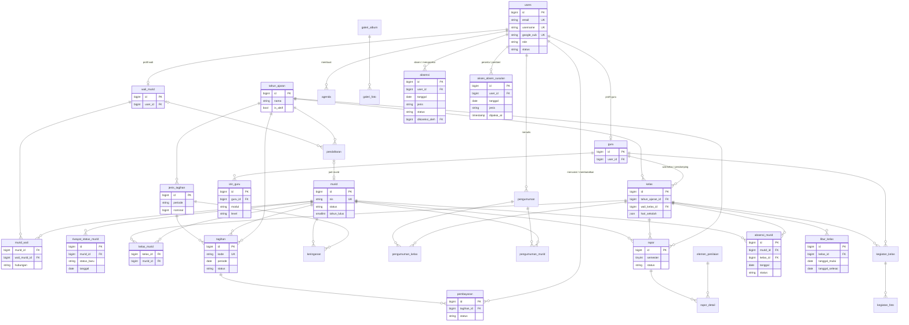
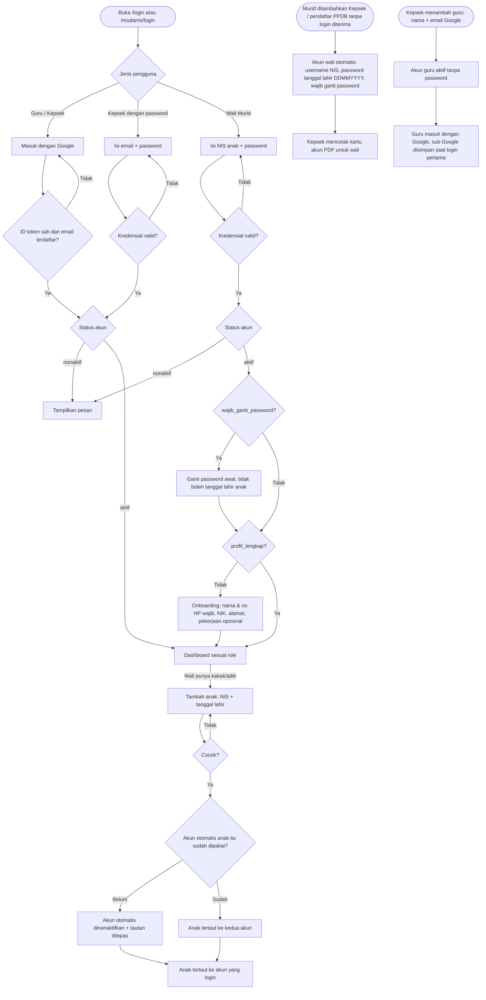
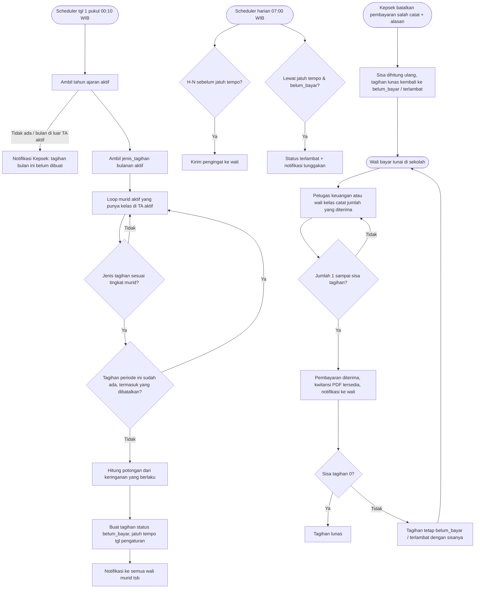
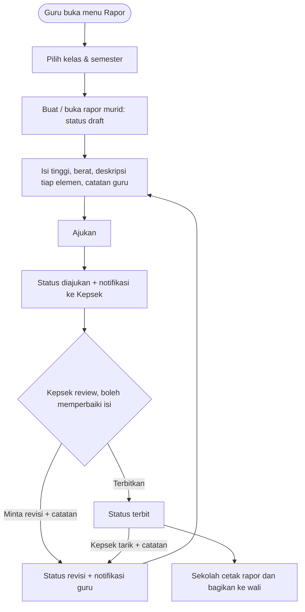
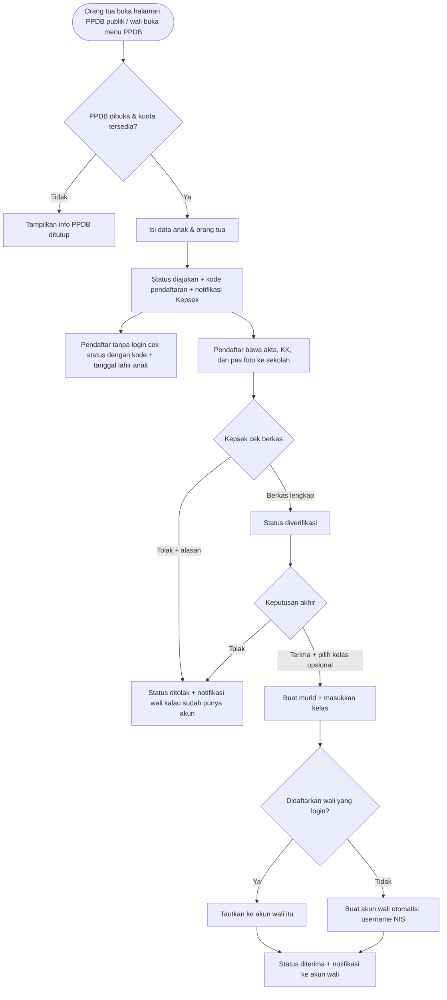
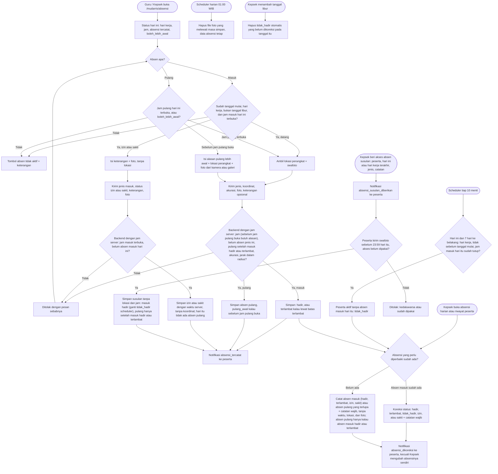
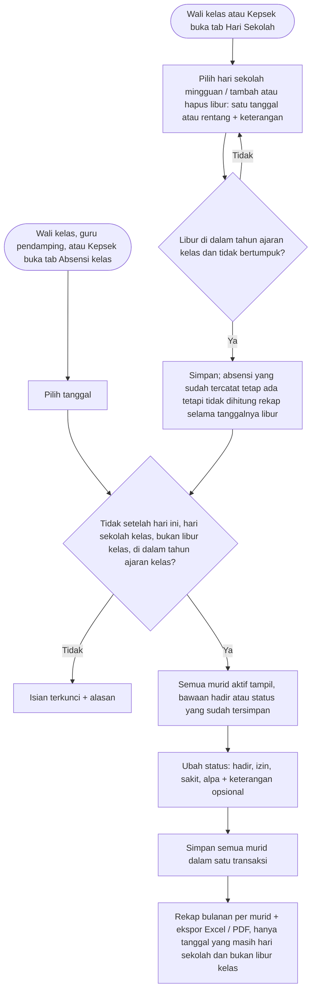
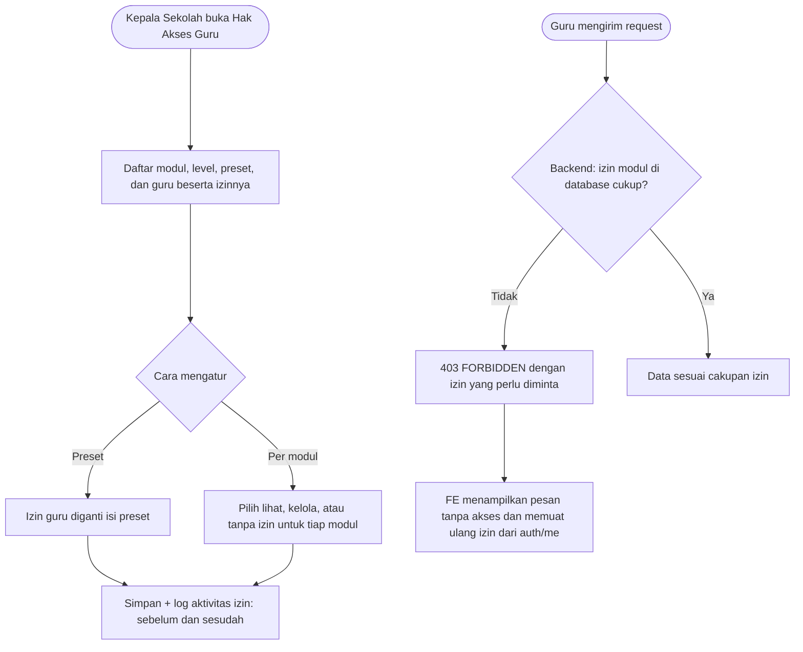
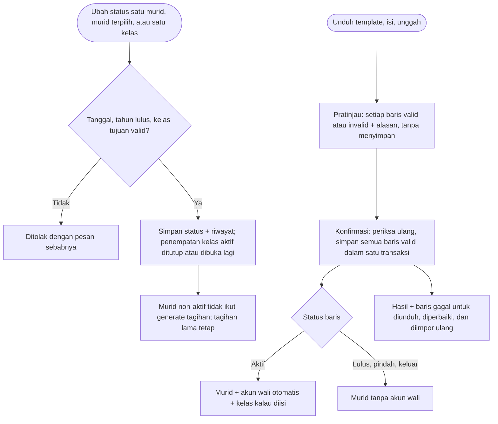

# PROMPT FRONTEND — Sistem Informasi TK Tarbiyatul Athfal 8

Kamu adalah senior frontend engineer (Next.js + TypeScript). Tugasmu membangun **website publik + dashboard** sistem informasi sekolah TK Tarbiyatul Athfal 8 di repo `FE_TK_Tarbiyathul_athfal_8`, dari nol, sesuai desain final di Bagian A. Backend Laravel ada di repo terpisah (`BE_TK_Tarbiyathul_athfal_8`) dan mengikuti kontrak API di A7 — **jangan mengarang endpoint atau field di luar A7**.

## Aturan kerja (WAJIB)

1. **Fase 0 dulu, tanpa menulis kode.** Baca seluruh prompt, cek versi Next.js/Tailwind/shadcn yang tersedia sekarang (perhatikan perubahan API antar versi, misal nama file middleware/proxy di Next.js terbaru), lalu tulis rencana (struktur folder, daftar route, komponen bersama, arah desain visual, risiko). Tampilkan rencana + pertanyaan (kalau ada), lalu **tunggu konfirmasiku**.
2. Kerjakan **per fase** (Bagian D). Di akhir tiap fase: jalankan `npm run lint`, `npm run typecheck` (`tsc --noEmit`), `npm run build`, `npm run check:slop`, pastikan bersih, review ulang kode & tampilan terhadap checklist Bagian C (anti AI-slop), update `dokumentasi.md`, lalu **berhenti dan laporkan**. Jangan lompat fase tanpa konfirmasi.
3. Tulis **file lengkap**, jangan potongan/diff parsial, jangan ada placeholder yang tidak jalan.
4. **TypeScript strict, DILARANG memakai tipe `any`** (termasuk `as any`, `any[]`, `Record<string, any>`). Pakai tipe dari kontrak, `unknown` + narrowing, atau generic. Aktifkan rule ESLint `@typescript-eslint/no-explicit-any: "error"`.
5. Kalau ada yang ambigu atau bertentangan dengan desain, **tanyakan**. Jangan mengubah alur/kontrak diam-diam.
6. Semua teks UI dalam **Bahasa Indonesia** yang ramah dan jelas untuk orang tua (hindari istilah teknis), dengan sapaan "Anda".

## `dokumentasi.md` (WAJIB)

Buat di root repo sejak Fase 1, dan selalu diperbarui. Isinya:
- Ringkasan proyek, stack + versi terpasang, cara install & menjalankan
- Daftar variabel `.env`
- **Changelog per fase**: setiap file baru dan file lama yang diubah, beserta alasan singkat
- Peta route + role yang boleh mengakses
- Keputusan teknis & desain yang diambil
- Status: fase selesai, sedang dikerjakan, dan yang tersisa; endpoint yang masih mock

Dokumen ini jadi acuan saat aku meminta prompt lanjutan, jadi harus akurat.
---

# BAGIAN A — DESAIN SISTEM (FINAL, JANGAN DIUBAH TANPA KONFIRMASI)

> Bagian ini sama persis di prompt FE dan BE. Ini acuan tunggal. Kalau kamu (agent) menemukan konflik atau hal yang tidak masuk akal, **tanyakan dulu**, jangan mengarang sendiri.

## A1. Ringkasan Sistem

Sistem Informasi Sekolah **TK Tarbiyatul Athfal 8** berbasis web (dan nanti mobile Flutter memakai API yang sama).

- **2 repo terpisah:**
  - `BE_TK_Tarbiyathul_athfal_8` → Laravel (REST API, token Sanctum, dokumentasi OpenAPI via Scramble)
  - `FE_TK_Tarbiyathul_athfal_8` → Next.js (App Router) + TypeScript + Tailwind CSS + shadcn/ui
- **3 role:**
  | Role (kode) | Siapa | Level |
  |---|---|---|
  | `super_admin` | Kepala Sekolah | Super Admin |
  | `guru` | Guru | Admin |
  | `wali_murid` | Orang tua / wali | User |
- **Murid TIDAK punya akun login.** Murid hanya data. Semua akses anak lewat akun wali murid (1 wali bisa punya beberapa anak, 1 anak bisa punya beberapa wali, misal ayah & ibu).
- **Absensi guru aktif dan Kepala Sekolah** berbasis lokasi dan foto (A2.12). **Absensi murid** dicatat guru per kelas (hadir, izin, sakit, alpa), tanpa lokasi dan foto; wali murid tidak melihatnya (A2.15).
- **Dua area dashboard terpisah**: wali murid di `/dashboard/...`, guru dan Kepala Sekolah di `/mudarris/...` (termasuk halaman akun: `/mudarris/login`, serta `/mudarris/lupa-password` dan `/mudarris/reset-password` khusus Kepala Sekolah). Di dalam `/mudarris`, menu, isi beranda, dan aksi menyesuaikan role dan izin modul guru (A2.13).
- Konten website publik (landing page, profil sekolah, galeri) diubah super admin, atau guru yang diberi izin modul `konten_website` (A2.13). Pengaturan sistem (aturan tagihan, PPDB, absensi) tetap khusus super admin.

## A2. Keputusan Desain Penting

1. **Login:**
   - Guru dan Kepala Sekolah → akun Google (Google Identity Services) dengan email yang sudah didaftarkan. Kepala Sekolah juga bisa login dengan email + password sebagai cadangan; guru tidak punya password.
   - Wali Murid → NIS anak (sebagai username) + password. Wali tidak mendaftar sendiri dan tidak punya email. Akun wali dibuat otomatis saat murid ditambahkan Kepala Sekolah atau pendaftaran PPDB diterima, kalau murid itu belum tertaut ke akun wali mana pun: role `wali_murid`, username = NIS murid, password awal = tanggal lahir anak (format DDMMYYYY), `wajib_ganti_password = true`, nama sementara "Wali <nama panggilan anak>", tertaut sebagai kontak utama (hubungan dari formulir PPDB, atau `wali` untuk murid yang ditambahkan Kepala Sekolah). Pendaftaran PPDB yang diajukan wali yang sudah login ditautkan ke akun wali itu, tanpa akun baru. Sekolah membagikan kartu akun (PDF) berisi NIS, tanpa password.
   - Selama `wajib_ganti_password = true`, akun wali hanya bisa membuka `GET /auth/me`, `PUT /auth/password`, dan `POST /auth/logout`. Password baru tidak boleh sama dengan tanggal lahir anak. Setelah itu wali melengkapi profil (onboarding). Wali yang lupa password meminta Kepala Sekolah mengembalikannya ke password awal.
   - Akun Kepala Sekolah dibuat lewat seeder (hanya 1 akun `super_admin` aktif), sekaligus profil `guru` miliknya (jabatan "Kepala Sekolah") supaya Kepala Sekolah bisa mencatat kegiatan kelas, menjadi wali kelas bila perlu, dan tampil di daftar guru landing. Profil guru ini tidak muncul di `GET /guru`, tidak bisa dinonaktifkan, izinnya tidak bisa diubah (Kepala Sekolah selalu punya semua izin), dan tidak dihitung sebagai guru di statistik dashboard; profil ini tetap bisa dibuka dan diubah lewat `GET/PUT /guru/{id}`.
   - Tidak ada pendaftaran guru mandiri. Kepala Sekolah membuat akun guru dengan nama dan email Google (unik tanpa membedakan huruf besar, disimpan huruf kecil); akun langsung `aktif`. Login Google tidak pernah membuat akun: email yang tidak terdaftar ditolak. `sub` akun Google disimpan saat login pertama dan login berikutnya harus dari akun Google yang sama; mengganti email guru melepas ikatan itu. Guru tidak dihapus, hanya dinonaktifkan, supaya riwayat datanya tetap utuh; akun nonaktif tidak bisa login.
2. **Menautkan anak ke wali:** setiap murid punya akun wali otomatis (A2.1). Wali yang sudah login menambahkan kakak/adik ke akunnya dengan NIS + tanggal lahir anak. Kalau akun otomatis anak itu belum pernah dipakai (password awal belum diganti), akun itu dinonaktifkan dan tautannya dilepas; kalau sudah dipakai, anak tetap tertaut ke akun itu dan ke akun yang menambahkannya (1 anak boleh punya beberapa akun wali, misal ayah & ibu). Super admin bisa melepas tautan.
3. **PPDB online:** orang tua mendaftarkan anak baru lewat halaman PPDB publik tanpa login saat PPDB dibuka, lalu memantau status dengan kode pendaftaran + tanggal lahir anak. Wali yang sudah punya akun juga bisa mendaftarkan kakak/adik lewat dashboard. Pendaftaran selalu untuk tahun ajaran di pengaturan `ppdb.tahun_ajaran_id` (biasanya tahun ajaran berikutnya, bukan yang sedang aktif). PPDB tidak bisa dibuka (`ppdb.dibuka = true` ditolak) kalau `ppdb.tahun_ajaran_id` belum diisi atau tahun ajarannya tidak ada. Kalau diterima, sistem otomatis membuat data murid lalu menautkannya ke wali pendaftar yang login, atau membuatkan akun wali otomatis (A2.1) untuk pendaftar tanpa login. Formulir tidak mengunggah berkas. Akta kelahiran, kartu keluarga, dan pas foto dibawa ke sekolah; status `diverifikasi` berarti berkas itu sudah diterima dan dicek di sekolah.
4. **Tagihan (SPP) otomatis:** scheduler membuat tagihan bulanan tiap tanggal 1 untuk semua murid aktif, berdasarkan `jenis_tagihan` berperiode `bulanan` yang aktif di tahun ajaran aktif. Idempoten (tidak dobel, dijaga unique index); tagihan yang `dibatalkan` tetap dihitung sudah ada, jadi pembatalan dihormati dan tagihan itu hanya bisa dipulihkan Kepala Sekolah lewat aktifkan kembali. Potongan dari tabel `keringanan` otomatis diterapkan. Petugas keuangan bisa mengubah jatuh tempo, potongan, dan catatan tagihan yang belum lunas; potongan tidak boleh membuat total di bawah yang sudah dibayar.
5. **Pembayaran:** tunai di sekolah. Petugas keuangan, atau wali kelas untuk murid di kelasnya (tahun ajaran aktif), mencatat jumlah yang diterima; pembayaran langsung `diterima`. **Tagihan boleh dicicil:** satu tagihan boleh punya banyak pembayaran, jumlah tiap pembayaran 1 sampai sisa, dan tagihan `lunas` saat jumlah pembayaran `diterima` sama dengan `total`. Tagihan yang baru dicicil tetap `belum_bayar` atau `terlambat` dengan sisanya. Guru pendamping tidak mencatat pembayaran. Kepala Sekolah bisa membatalkan pembayaran yang salah catat dengan alasan wajib; sisa dihitung ulang, tagihan lunas bisa kembali belum lunas, dan wali murid mendapat notifikasi yang menyebut tagihan, jumlah, alasan, dan sisa tagihan sekarang. Wali murid tidak mengunggah bukti dan tidak ada verifikasi. Riwayat transfer dari sebelum aturan ini tetap tampil. Payment gateway (Midtrans) = pengembangan nanti, bukan sekarang.
6. **Petugas keuangan:** super admin, ditambah guru yang diberi izin modul `keuangan` level `kelola` oleh super admin (preset Bendahara, A2.13).
7. **Tunggakan:** tagihan lewat jatuh tempo otomatis berstatus `terlambat` dan wali dapat notifikasi. Super admin/guru juga bisa membuat pengumuman dengan target `murid` tertentu (misal yang menunggak).
8. **Rapor perkembangan anak (Kurikulum Merdeka PAUD):** penilaian naratif per elemen. Elemen bisa dikelola super admin (seed awal: Nilai Agama & Budi Pekerti; Jati Diri; Dasar-dasar Literasi, Matematika, Sains, Teknologi, Rekayasa & Seni). Alur: guru draft → ajukan → kepala sekolah terbitkan atau minta revisi (kepala sekolah boleh memperbaiki isi rapor yang sedang diajukan). Rapor `terbit` adalah rapor final yang dicetak sekolah dan dibagikan langsung; wali murid tidak membuka rapor di aplikasi. Wali kelas, guru pendamping kelas itu, dan Kepala Sekolah bisa mengunduh satu PDF berisi semua rapor `terbit` satu kelas dan semester untuk dicetak sekaligus (template sama dengan PDF per murid sampai contoh kertas rapor dari sekolah tersedia). Rapor terbit bisa ditarik kepala sekolah kembali ke revisi dengan catatan.
9. **Privasi foto anak:** foto kegiatan kelas, bukti bayar, foto rapor, dan lampiran pengumuman disimpan di disk **private**, diakses via endpoint terotorisasi / signed URL (lampiran pengumuman publik lewat endpoint publik khusus). Hanya galeri publik & aset landing yang di disk public.
10. **Uang** disimpan sebagai integer rupiah (tanpa desimal). **Zona waktu** `Asia/Jakarta`, bahasa `id`.
11. **Notifikasi** memakai Laravel database notifications (channel mail opsional). Push notification (FCM) nanti saat Flutter.
12. **Absensi guru dan Kepala Sekolah:** peserta absensi adalah guru yang akunnya `aktif` dan Kepala Sekolah. Guru nonaktif tidak ikut absensi dan tidak ditandai tidak hadir. Absen masuk dan absen pulang dilakukan dari HP di `/mudarris/absensi` dengan lokasi perangkat dan swafoto. Semua keputusan diambil backend dengan jam server (`Asia/Jakarta`): hari ini tidak sebelum tanggal mulai absensi, hari kerja dan bukan tanggal libur, di dalam jam jenis absen itu, jarak ke titik sekolah (Haversine) tidak melebihi radius, akurasi lokasi tidak melebihi batas, belum absen jenis itu hari ini, dan absen pulang hanya setelah absen masuk. Jarak yang ditampilkan FE hanya informasi. Jam masuk dan jam pulang boleh berbeda per hari kerja: Kepala Sekolah mengisi jam khusus untuk hari tertentu dalam seminggu (berlaku tetap setiap minggu), hari lain memakai jam bawaan, dan semua aturan yang memakai jam (status terlambat, jam terbuka, pulang lebih awal, tanda tidak hadir dari scheduler, dan tidak absen pulang di rekap) memakai jam hari itu. Status absen masuk `hadir` atau `terlambat` menurut batas terlambat; absen pulang tidak punya status. Peserta yang tidak bisa datang mencatat `izin` atau `sakit` sendiri di jam absen masuk dengan keterangan dan foto, tanpa lokasi; hari itu tidak ada absen pulang. Peserta yang perlu pulang sebelum jam pulang buka bisa absen pulang lebih awal dengan alasan, tanpa persetujuan; lokasi dan foto tetap diperiksa. Peserta mendapat notifikasi setiap absennya tercatat dan setiap Kepala Sekolah mengoreksi atau mencatat absensinya. Setelah jam masuk hari itu tutup di hari kerja, scheduler menandai peserta yang belum absen masuk sebagai `tidak_hadir`, termasuk susulan hari kerja yang terlewat sampai 7 hari ke belakang, tetapi tidak pernah untuk tanggal sebelum tanggal mulai absensi. Kalau Kepala Sekolah menambahkan tanggal libur, tanda `tidak_hadir` buatan scheduler yang belum dikoreksi pada tanggal itu dihapus; absen sungguhan dan baris yang sudah dikoreksi tetap. Kepala Sekolah bisa mengoreksi status absen masuk dengan catatan wajib; pengoreksi dan waktunya dicatat. Guru tidak bisa absen untuk hari yang sudah lewat: kalau peserta lupa absen padahal masuk dan belum punya absen masuk di tanggal itu (misalnya hari ini sebelum jam masuk tutup), Kepala Sekolah mencatat absen masuk `hadir` atau `terlambat` untuk tanggal itu dengan catatan wajib, tanpa waktu, lokasi, dan foto, dan baris itu langsung dianggap sudah dikoreksi. Hal yang sama untuk peserta yang lupa absen pulang: Kepala Sekolah mencatat absen pulang untuk tanggal yang sudah punya absen masuk `hadir` atau `terlambat` dan belum punya absen pulang. Koreksi dan pencatatan oleh Kepala Sekolah boleh melampirkan satu foto atau dokumen PDF (misalnya surat dokter atau surat tugas); lampiran disimpan di disk private, hanya dikirim ke pemilik absensi, Kepala Sekolah, dan pemegang izin lihat laporan absensi, dan dihapus bersama foto setelah masa simpan. **Akses absen susulan:** kalau peserta tidak bisa absen karena kendala di sekolah (misalnya wifi mati), Kepala Sekolah (hanya Kepala Sekolah; tidak ikut izin `laporan_absensi`) memberi akses untuk satu peserta, satu tanggal (hari ini atau hari kerja terakhir sebelumnya yang bukan tanggal libur), dan satu jenis absen, dengan catatan wajib; untuk masuk dan pulang diberikan dua akses. Akses sekali pakai, berlaku sampai akhir hari diberikan (23:59 WIB), tidak untuk Kepala Sekolah sendiri, dan ditolak kalau absensi jenis itu sudah ada (kecuali tanda `tidak_hadir` buatan scheduler yang belum dikoreksi) atau akses yang sama masih aktif. Peserta absen sendiri dengan swafoto tanpa pemeriksaan lokasi dan jam: absen masuk susulan berstatus `hadir` dengan waktu server saat dikirim dan mengganti tanda `tidak_hadir` scheduler di tanggal itu; absen pulang susulan hanya setelah absen masuk tanggal itu `hadir` atau `terlambat`; barisnya bertanda `susulan`. Akses yang belum dipakai tidak menahan scheduler, dan baris susulan tidak dihapus kalau tanggalnya dijadikan libur. Kepala Sekolah melihat absensi semua peserta per tanggal selain rekap 1–3 bulan; ekspor rekap berisi jumlah per peserta dan jam masuk serta jam pulang tiap peserta per hari, seperti buku absen di sekolah. Foto absensi disimpan di disk private, hanya bisa dibuka pemiliknya dan Kepala Sekolah, dan file-nya dihapus setelah masa simpan (data absensinya tetap). Aturan absensi (titik sekolah, radius, batas akurasi, jam bawaan dan jam khusus per hari, hari kerja, tanggal libur, tanggal mulai, masa simpan foto) diatur Kepala Sekolah di pengaturan grup `absensi`.
13. **Hak akses guru:** Kepala Sekolah memberi guru izin per modul dengan level `lihat` atau `kelola` (`kelola` mencakup `lihat`): `keuangan` (semua tagihan dan pembayaran, keringanan, laporan, tunggakan; kelola = keringanan, tagihan sekali bayar, ubah tagihan, catat pembayaran), `konten_website` (profil sekolah, landing page, banner beranda wali, galeri), `laporan_absensi` (rekap, absensi harian, riwayat dan foto peserta lain; kelola = koreksi dan pencatatan absensi peserta lain, tidak untuk absensinya sendiri dan tidak termasuk memberi akses absen susulan), `data_murid` (semua murid dan alumni; kelola = tambah, ubah, hapus, status, import, kartu akun wali), dan `pengumuman` (semua pengumuman termasuk draft; kelola = target apa pun, tampil di website, ubah dan hapus pengumuman siapa pun). Preset (Bendahara, Admin Website, Admin Absensi, Tata Usaha) mengganti seluruh izin guru lalu bisa disesuaikan per modul. Manajemen guru, manajemen izin, pengaturan absensi, dan bagian lain di luar kelima modul tetap khusus Kepala Sekolah. Izin diperiksa backend di setiap route terkait dan dibaca dari database di setiap request, jadi pencabutan berlaku di request berikutnya. FE membangun menu, penjaga halaman, dan tombol aksi dari `izin` di `GET /auth/me`. Setiap perubahan izin dan setiap aksi di modul keuangan dicatat di log aktivitas.
14. **Status murid, alumni, dan import:** status murid `aktif`, `lulus`, `pindah`, atau `keluar` beserta tanggal status, tahun lulus (lulus), sekolah tujuan (pindah), dan keterangan; setiap perubahan dicatat di riwayat status. Status diubah per murid, massal untuk murid terpilih, atau meluluskan satu kelas sekaligus untuk tahun tertentu; kenaikan kelas dengan status lulus juga mengisi tahun lulus dan riwayat. Murid lulus, pindah, dan keluar keluar dari penempatan kelas aktif dan tidak ikut generate tagihan berikutnya; tagihan lamanya tetap tercatat. Alumni dicari per tahun lulus. Murid bisa diimpor dari Excel/CSV lewat template: pratinjau memeriksa setiap baris (valid/invalid beserta alasan) tanpa menyimpan, lalu simpan meng-commit semua baris valid dalam satu transaksi dan mengembalikan baris yang gagal. Duplikat dideteksi lewat NISN, atau nama lengkap + tanggal lahir untuk baris tanpa NISN. Murid aktif hasil import mengikuti aturan akun wali otomatis (A2.1); murid lulus, pindah, dan keluar tidak dibuatkan akun wali. Untuk alumni, NISN dan tanggal status opsional; alumni lulus tanpa tanggal memakai akhir tahun ajaran di tahun lulusnya. Akun wali yang semua anaknya sudah tidak aktif tetap aktif (tagihan lama, kwitansi, PPDB adik), tetapi tidak lagi menerima pengumuman untuk semua dan untuk wali murid.

15. **Absensi murid:** wali kelas dan guru pendamping kelas itu di tahun ajaran aktif, serta Kepala Sekolah, mencatat absensi harian semua murid berpenempatan aktif di satu kelas sekaligus (bawaan hadir), dengan status `hadir`, `izin`, `sakit`, atau `alpa` dan keterangan opsional. Satu murid satu baris per tanggal; penyimpanan satu kelas dalam satu transaksi dan wajib memuat semua murid aktif kelas itu. Tanggal tidak setelah hari ini, termasuk hari sekolah kelas itu, bukan tanggal libur kelas itu, dan di dalam rentang tahun ajaran kelas itu; tanggal yang sudah lewat boleh diubah. Absensi murid tidak memakai `absensi.hari_kerja` dan `absensi.tanggal_libur` milik absensi guru: tiap kelas punya hari sekolah mingguan (nomor hari ISO; kelas yang sudah ada saat aturan ini dipasang dan kelas baru mulai dengan isi `absensi.hari_kerja` saat itu) dan daftar libur sendiri (satu tanggal atau rentang, dengan keterangan, di dalam tahun ajaran kelas, tidak bertumpuk). Keduanya diatur wali kelas kelas itu (tahun ajaran aktif) dan Kepala Sekolah; guru pendamping hanya melihat. Absensi yang sudah tercatat pada tanggal yang kemudian dijadikan libur atau dilepas dari hari sekolah tidak dihapus, tetapi tidak dihitung di rekap dan ekspor selama aturan kelas itu masih begitu. Guru lain, termasuk pemegang izin `data_murid`, tidak bisa membuka atau mencatat (404); wali murid tidak melihat absensi murid. Rekap bulanan per murid (jumlah tiap status dan jumlah hari tercatat) bisa diekspor .xlsx dan PDF berkop sekolah. Tidak ada log aktivitas per penyimpanan; `dicatat_oleh` menyimpan pencatat terakhir.

## A3. Use Case per Aktor

**Publik (tanpa login)**
- Melihat landing page (profil, visi-misi, program, fasilitas, guru, galeri, pengumuman publik, agenda publik, info PPDB, kontak)
- Melihat daftar & detail pengumuman publik, galeri
- Daftar PPDB tanpa login & cek status pendaftaran dengan kode pendaftaran + tanggal lahir anak
- Login (guru dan Kepala Sekolah dengan Google, Kepala Sekolah juga dengan email + password, wali murid dengan NIS anak), lupa/reset password (Kepala Sekolah)

**Wali Murid (User)**
- Login dengan NIS anak + password, ganti password awal saat login pertama, lengkapi profil (onboarding)
- Tambah kakak/adik dengan NIS + tanggal lahir anak; lihat daftar anak; pindah anak aktif (switcher)
- Beranda: info sekolah (banner dari Kepala Sekolah), ringkasan tagihan, kegiatan kelas terbaru, pengumuman, agenda
- Lihat tagihan anak beserta sisanya dan riwayat pembayaran, unduh kwitansi; pembayaran dilakukan tunai di sekolah
- Lihat kegiatan/dokumentasi kelas anak (foto)
- Lihat pengumuman yang relevan (semua / wali / kelas anak / anaknya)
- Lihat agenda sekolah
- Daftar PPDB untuk kakak/adik & pantau statusnya
- Notifikasi, edit profil (nama, nomor HP, alamat, pekerjaan, NIK), ganti password

**Guru (Admin)**
- Login dengan akun Google yang emailnya didaftarkan Kepala Sekolah
- Beranda: kelas saya, jumlah murid, progres rapor, kegiatan terakhir, pengumuman
- Kelas saya: daftar murid kelas yang diampu (sebagai wali kelas / pendamping), detail murid & kontak wali
- Kelola kegiatan kelas (judul, tema, deskripsi, foto beserta keterangan dan urutannya)
- Kelola rapor murid kelasnya (draft, isi per elemen, ajukan, perbaiki saat revisi); unduh semua rapor terbit kelasnya per semester dalam satu PDF
- Buat pengumuman untuk kelasnya / murid di kelasnya, dengan lampiran opsional (PDF atau gambar)
- Lihat status tagihan murid kelasnya; wali kelas mencatat pembayaran tunai murid kelasnya dan mengunduh kwitansinya
- Wali kelas dan guru pendamping: catat absensi harian murid kelasnya (hadir, izin, sakit, alpa), lihat rekap bulanan, ekspor Excel dan PDF; wali kelas mengatur hari sekolah mingguan dan tanggal libur kelasnya, guru pendamping melihatnya
- Lihat agenda
- **Dengan izin modul dari Kepala Sekolah (A2.13)**: membuka bagian keuangan, konten website, laporan absensi, data murid (termasuk status, alumni, dan import), atau pengumuman sesuai level lihat atau kelola
- Absen masuk dan absen pulang dengan lokasi dan foto, catat izin atau sakit dengan keterangan dan foto, absen pulang lebih awal dengan alasan, absen susulan dengan swafoto kalau diberi akses Kepala Sekolah, lihat status hari ini dan riwayat absensinya sendiri, dan menerima notifikasi saat absensinya tercatat, dikoreksi, atau diberi akses susulan
- Notifikasi, edit profil

**Kepala Sekolah (Super Admin)**
- Semua yang bisa guru lakukan (lihat semua kelas)
- Beranda: statistik sekolah + daftar tindakan tertunda (rapor menunggu review, pendaftar PPDB baru)
- Kelola guru: tambah (nama + email Google), edit, aktif/nonaktifkan (tanpa hapus), atur hak akses per modul (termasuk preset), tampilkan di landing
- Kelola tahun ajaran (aktifkan 1), kelas (wali kelas, pendamping, kapasitas), penempatan murid, kenaikan kelas massal
- Kelola murid (CRUD, ubah status satu murid atau massal termasuk meluluskan satu kelas, riwayat status, alumni per tahun lulus, import dari Excel/CSV, unduh kartu akun wali, ubah hubungan & kontak utama wali, lepas tautan wali), lihat & ubah data wali murid, reset password wali murid
- Keuangan: jenis tagihan, keringanan, generate tagihan manual (idempoten), tagihan sekali bayar (uang pendidikan/seragam), ubah jatuh tempo/potongan/catatan tagihan, catat pembayaran tunai (boleh dicicil), batalkan pembayaran yang salah catat, batalkan tagihan dan aktifkan kembali, laporan & ekspor Excel, daftar tunggakan
- Rapor: review, perbaiki isi sebelum terbit, terbitkan, minta revisi, tarik rapor terbit; unduh rapor terbit satu kelas dalam satu PDF; kelola elemen penilaian
- Absensi murid semua kelas: catat harian, atur hari sekolah dan tanggal libur tiap kelas, rekap bulanan, ekspor Excel dan PDF
- Pengumuman (semua target, dengan lampiran opsional) & agenda
- PPDB: buka/tutup, verifikasi, terima (pilih kelas), tolak
- **CMS website:** profil sekolah, konten landing, galeri
- Pengaturan: tanggal jatuh tempo, hari pengingat, info PPDB, banner info di beranda wali murid
- Absensi: ikut absen seperti guru; atur titik sekolah, radius, batas akurasi, jam masuk dan pulang (jam bawaan dan jam khusus per hari kerja), hari kerja, tanggal libur, tanggal mulai absensi, dan masa simpan foto; koreksi status absensi dengan catatan dan lampiran foto atau PDF opsional, termasuk mencatat absen masuk atau absen pulang untuk peserta yang lupa absen; memberi dan mencabut akses absen susulan; lihat absensi semua peserta di satu tanggal; rekap 1–3 bulan per peserta (termasuk izin dan sakit), detail per hari dengan jam dan foto, dan ekspor Excel (.xlsx) dan PDF berkop sekolah berisi jumlah per peserta dan jam masuk serta jam pulang tiap hari
- Log aktivitas

## A4. ERD



### Detail tabel

Semua tabel punya `id` (bigint PK) dan `created_at/updated_at` kecuali pivot yang disebut. Nama tabel bahasa Indonesia → set `$table` eksplisit di model.

- **users**: name, email (nullable unique, disimpan huruf kecil; wali murid tidak punya email), username (nullable unique; NIS anak untuk wali murid, kosong untuk guru dan Kepala Sekolah), password (nullable; guru tidak punya password), google_sub (nullable unique; `sub` akun Google guru/Kepala Sekolah, diisi saat login Google pertama), wajib_ganti_password (bool, default false; true selama wali memakai password awal), role (enum Role), status (enum StatusAkun), no_hp (nullable), avatar_path (nullable), email_verified_at, last_login_at, remember_token, deleted_at (soft delete)
- **guru**: user_id (FK unique), nip (nullable), nuptk (nullable), jenis_kelamin (L/P), tempat_lahir, tanggal_lahir, alamat, pendidikan_terakhir, jabatan (string, misal "Guru Kelas"), foto_path, tampil_di_landing (bool, default false)
- **wali_murid**: user_id (FK unique), nik (nullable), pekerjaan, alamat, profil_lengkap (bool, default false)
- **murid**: nis (unique, auto format `TA{tahun}{urut 4 digit}`), nisn (nullable unique), nik (nullable), nama_lengkap, nama_panggilan, jenis_kelamin, tempat_lahir, tanggal_lahir, agama, alamat, anak_ke (nullable), foto_path (nullable), catatan_khusus (nullable, misal alergi makanan / kebutuhan khusus — hanya terlihat guru & kepsek & wali anak itu), status (enum StatusMurid), tanggal_masuk, tanggal_keluar (nullable; tanggal lulus, pindah, atau keluar), tahun_lulus (smallint nullable, hanya status lulus), sekolah_tujuan (nullable, hanya status pindah), keterangan_status (text nullable), deleted_at
- **izin_guru**: guru_id (FK guru, cascade), modul (enum ModulIzin), level (enum LevelIzin). Unique (guru_id, modul). Tidak ada baris berarti guru tidak punya izin modul itu
- **riwayat_status_murid**: murid_id (FK murid, cascade), status_lama, status_baru (enum StatusMurid), tanggal (date), tahun_lulus (nullable), sekolah_tujuan (nullable), keterangan (nullable), diubah_oleh (FK users nullable)
- **murid_wali** (pivot): murid_id, wali_murid_id, hubungan (enum Hubungan), is_kontak_utama (bool), created_at. Unique (murid_id, wali_murid_id)
- **tahun_ajaran**: nama ("2026/2027"), tanggal_mulai, tanggal_selesai, semester_aktif (1/2), is_aktif (hanya 1 yang true)
- **kelas**: tahun_ajaran_id, nama ("TK A1"), tingkat (enum Tingkat), wali_kelas_id (FK guru, nullable), guru_pendamping_id (FK guru, nullable), kapasitas (int, default 20), hari_sekolah (json int[] nomor hari ISO untuk absensi murid; diisi dari `absensi.hari_kerja` saat kelas dibuat dan saat kolom ini ditambahkan)
- **kelas_murid**: kelas_id, murid_id, status (enum StatusKelasMurid, default aktif). Unique (kelas_id, murid_id). Aturan: 1 murid hanya boleh 1 kelas per tahun ajaran (validasi di service)
- **jenis_tagihan**: tahun_ajaran_id, nama ("SPP", "Uang Kegiatan", "Seragam"), deskripsi, nominal (unsigned bigint), periode (enum PeriodeTagihan), tingkat (nullable enum Tingkat; null = semua tingkat), is_aktif
- **keringanan**: murid_id, jenis_tagihan_id, tipe (enum TipeKeringanan), nilai (int; persen 1–100 atau rupiah), alasan, berlaku_mulai (date), berlaku_sampai (date nullable), dibuat_oleh (FK users)
- **tagihan**: kode (unique, `INV-YYYYMM-XXXXX`), murid_id, jenis_tagihan_id, tahun_ajaran_id, periode (date nullable, selalu tanggal 1 bulan tsb; null untuk tagihan sekali), nominal, potongan, total, jatuh_tempo (date), status (enum StatusTagihan), lunas_at (nullable), dibuat_oleh (FK users nullable; null = sistem), catatan. **Unique (murid_id, jenis_tagihan_id, periode)**, termasuk tagihan yang `dibatalkan`: tagihan bulanan yang dibatalkan tidak dibuat ulang, tetapi bisa diaktifkan kembali
- **pembayaran**: kode (unique, `PAY-YYYYMMDD-XXXXX`), tagihan_id, dibayar_oleh (FK users nullable), metode (enum MetodeBayar), jumlah, tanggal_bayar, bukti_path (nullable, private), bank_pengirim (nullable), nama_pengirim (nullable), status (enum StatusPembayaran), alasan_penolakan (nullable), diverifikasi_oleh (FK users nullable; petugas yang mencatat pembayaran tunai), diverifikasi_at, alasan_pembatalan (nullable), dibatalkan_oleh (FK users nullable), dibatalkan_at (nullable). 1 tagihan boleh punya banyak pembayaran `diterima` (cicilan); jumlahnya tidak melebihi `total`. `dibayar_oleh`, `bukti_path`, `bank_pengirim`, `nama_pengirim`, dan `alasan_penolakan` hanya terisi di riwayat transfer lama
- **pengumuman**: judul, slug (unique), isi (HTML, disanitasi), lampiran_path (nullable, private), lampiran_nama (nullable, nama file asli), lampiran_ukuran (nullable, byte), target (enum TargetPengumuman), is_publik (bool, tampil di landing; hanya boleh jika target `semua`), is_pinned (bool), penulis_id (FK users), published_at (nullable = draft), deleted_at
- **pengumuman_kelas**: pengumuman_id, kelas_id. **pengumuman_murid**: pengumuman_id, murid_id
- **agenda**: judul, deskripsi, tanggal_mulai, tanggal_selesai, jenis (enum JenisAgenda), is_publik, dibuat_oleh
- **kegiatan_kelas**: kelas_id, guru_id, tanggal, tema, judul, deskripsi. **kegiatan_foto**: kegiatan_kelas_id, path (private), caption, urutan
- **elemen_penilaian**: kode, nama, deskripsi, urutan, is_aktif
- **rapor**: murid_id, kelas_id, tahun_ajaran_id, semester (1/2), tinggi_badan (decimal nullable, cm), berat_badan (decimal nullable, kg), catatan_guru, status (enum StatusRapor), catatan_revisi (nullable), dibuat_oleh (FK guru), diajukan_at, disetujui_oleh (FK users nullable), terbit_at. Unique (murid_id, tahun_ajaran_id, semester)
- **rapor_detail**: rapor_id, elemen_penilaian_id, deskripsi (text), foto_path (nullable, private). Unique (rapor_id, elemen_penilaian_id)
- **pendaftaran**: kode (unique, `PPDB-YYYY-XXXX`), wali_murid_id (nullable; kosong untuk pendaftaran tanpa login, diisi akun wali otomatis saat diterima), hubungan (enum Hubungan; hubungan wali pendaftar dengan anak, dipakai saat menautkan ketika diterima), tahun_ajaran_id (diisi dari `ppdb.tahun_ajaran_id` saat mendaftar), tingkat_tujuan, nama_lengkap, nama_panggilan, jenis_kelamin, tempat_lahir, tanggal_lahir, nik, agama, alamat, nama_ayah, pekerjaan_ayah, nama_ibu, pekerjaan_ibu, no_hp, status (enum StatusPendaftaran), catatan (nullable), diproses_oleh (nullable), diproses_at, murid_id (nullable, terisi saat diterima)
- **galeri_album**: judul, slug, deskripsi, cover_path, tanggal, is_publik. **galeri_foto**: galeri_album_id, path (public), caption, urutan
- **absensi**: user_id (FK users; guru atau Kepala Sekolah), tanggal (date), jenis (enum JenisAbsensi), status (nullable enum StatusAbsensi; hanya untuk jenis `masuk`), waktu (timestamp nullable, jam server saat absen; null untuk `tidak_hadir` dari scheduler dan baris yang dicatat Kepala Sekolah), latitude dan longitude (decimal 10,7 nullable), akurasi_meter (int nullable), jarak_meter (int nullable, jarak ke titik sekolah saat absen), foto_path (nullable, private; dikosongkan saat file dihapus setelah masa simpan), lampiran_path (nullable, private; foto atau PDF dari koreksi atau pencatatan Kepala Sekolah, dikosongkan bersama foto setelah masa simpan), keterangan (text nullable, maks 500; alasan dari peserta untuk izin, sakit, atau pulang lebih awal), pulang_awal (bool, default false; absen pulang sebelum jam pulang buka), susulan (bool, default false; dikirim lewat akses absen susulan), catatan_koreksi (nullable), dikoreksi_oleh (FK users nullable), dikoreksi_at (nullable). **Unique (user_id, tanggal, jenis)**
- **akses_absen_susulan**: user_id (FK users; peserta), tanggal (date), jenis (enum JenisAbsensi), catatan (text; alasan dari Kepala Sekolah), diberikan_oleh (FK users), berlaku_sampai (datetime; akhir hari akses diberikan), dipakai_at (nullable). Index (user_id, tanggal). Dihapus saat dicabut sebelum dipakai
- **absensi_murid**: murid_id (FK murid), kelas_id (FK kelas; kelas tempat absensi dicatat), tanggal (date), status (enum StatusAbsensiMurid), keterangan (nullable, maks 255), dicatat_oleh (FK users; pencatat terakhir). **Unique (murid_id, tanggal)**, index (kelas_id, tanggal)
- **libur_kelas**: kelas_id (FK kelas, cascade), tanggal_mulai (date), tanggal_selesai (date; sama dengan tanggal_mulai untuk libur satu hari), keterangan (maks 100). Index (kelas_id, tanggal_mulai). Rentang satu kelas tidak bertumpuk (diperiksa service)
- **pengaturan**: kunci (unique), nilai (json), grup (string: profil | landing | keuangan | ppdb | beranda | absensi)
- Tabel bawaan: personal_access_tokens, notifications, password_reset_tokens, jobs, failed_jobs, activity_log (spatie)

### Kunci pengaturan (seed default)

| kunci | isi |
|---|---|
| `profil.nama_sekolah` | "TK Tarbiyatul Athfal 8" |
| `profil.npsn`, `profil.alamat`, `profil.telepon`, `profil.email`, `profil.maps_embed_url` | string |
| `profil.logo` | path gambar |
| `profil.visi` | string |
| `profil.misi` | string[] |
| `profil.sejarah`, `profil.sambutan_kepsek` | string (HTML) |
| `landing.hero` | { judul, subjudul, gambar, cta_teks } |
| `landing.program` | { judul, deskripsi, ikon }[] |
| `landing.fasilitas` | { nama, deskripsi, gambar }[] |
| `landing.keunggulan` | { judul, deskripsi, ikon }[] |
| `keuangan.tanggal_jatuh_tempo` | int (default 10) |
| `keuangan.hari_pengingat` | int (default 3, H-3 sebelum jatuh tempo) |
| `ppdb.dibuka` | bool |
| `ppdb.tanggal_buka`, `ppdb.tanggal_tutup` | date |
| `ppdb.tahun_ajaran_id` | int (id tahun ajaran tujuan PPDB; wajib terisi dengan tahun ajaran yang ada sebelum `ppdb.dibuka` bisa `true`) |
| `ppdb.kuota` | int |
| `ppdb.info` | string (HTML: syarat, biaya, alur) |
| `beranda.info_wali` | { aktif: bool, judul: string (maks 100), isi: string (teks biasa, maks 1000), nada: NadaInfo, berlaku_sampai: date \| null }; judul dan isi wajib kalau `aktif`. Default nonaktif |
| `absensi.lokasi` | { latitude, longitude } \| null (default null; selama null semua absen ditolak) |
| `absensi.radius_meter` | int 10–5000 (default 100) |
| `absensi.batas_akurasi_meter` | int 5–1000 (default 100) |
| `absensi.jam_masuk` | { buka, batas_terlambat, tutup } format `HH:MM`, berurutan (default 06:30, 07:15, 09:00); jam bawaan untuk hari tanpa jam khusus |
| `absensi.jam_pulang` | { buka, tutup } format `HH:MM` (default 11:00, 15:00); jam bawaan untuk hari tanpa jam khusus |
| `absensi.jam_khusus` | { hari, jam_masuk: { buka, batas_terlambat, tutup }, jam_pulang: { buka, tutup } }[] (default kosong, urut `hari`). Jam per hari yang berlaku tetap setiap minggu: `hari` nomor hari ISO yang ada di `absensi.hari_kerja`, tidak dobel; jam masuk dan jam pulang wajib dan berurutan seperti jam bawaan. Hari yang tidak ada di daftar memakai `absensi.jam_masuk` dan `absensi.jam_pulang` |
| `absensi.hari_kerja` | int[] nomor hari ISO, 1 = Senin sampai 7 = Minggu (default 1–6); hanya absensi guru dan Kepala Sekolah, juga nilai awal `kelas.hari_sekolah` |
| `absensi.tanggal_libur` | date[] (default kosong); hanya absensi guru dan Kepala Sekolah |
| `absensi.masa_simpan_foto_bulan` | int 1–60 (default 6) |
| `absensi.tanggal_mulai` | date (default tanggal migration dijalankan); sebelum tanggal ini absen ditolak dan tidak ada yang ditandai tidak hadir |

## A5. Enum (nilai string, dipakai sama di BE & FE)

- **Role**: `super_admin`, `guru`, `wali_murid`
- **StatusAkun**: `aktif`, `nonaktif`
- **StatusMurid**: `aktif`, `lulus`, `pindah`, `keluar`
- **Hubungan**: `ayah`, `ibu`, `wali`
- **Tingkat**: `A`, `B`
- **StatusKelasMurid**: `aktif`, `naik`, `tinggal`, `lulus`, `keluar`
- **PeriodeTagihan**: `bulanan`, `sekali`
- **TipeKeringanan**: `persen`, `nominal`
- **StatusTagihan**: `belum_bayar`, `menunggu_verifikasi` (hanya data lama, tidak dibuat lagi), `lunas`, `terlambat`, `dibatalkan`
- **MetodeBayar**: `transfer` (hanya data lama, tidak dibuat lagi), `tunai`
- **StatusPembayaran**: `menunggu` dan `ditolak` (hanya data lama, tidak dibuat lagi), `diterima`, `dibatalkan`
- **TargetPengumuman**: `semua`, `guru`, `wali_murid`, `kelas`, `murid`
- **JenisAgenda**: `kegiatan`, `libur`, `rapat`, `lainnya`
- **StatusRapor**: `draft`, `diajukan`, `revisi`, `terbit`
- **StatusPendaftaran**: `diajukan`, `diverifikasi`, `diterima`, `ditolak`
- **NadaInfo**: `info`, `penting`, `peringatan`
- **JenisAbsensi**: `masuk`, `pulang`
- **StatusAbsensi**: `hadir`, `terlambat`, `tidak_hadir`, `izin`, `sakit`
- **StatusAbsensiMurid**: `hadir`, `izin`, `sakit`, `alpa`
- **ModulIzin**: `keuangan`, `konten_website`, `laporan_absensi`, `data_murid`, `pengumuman`
- **LevelIzin**: `lihat`, `kelola`
- **PresetIzin**: `bendahara`, `admin_website`, `admin_absensi`, `tata_usaha`

## A6. Flowchart

### Autentikasi & onboarding



### Tagihan bulanan & pembayaran



### Rapor



### PPDB



### Absensi guru dan Kepala Sekolah



### Absensi murid



### Hak akses guru



### Status murid dan import



## A7. Kontrak API

**Base URL:** `{BE_URL}/api/v1`. Auth: header `Authorization: Bearer {token}` (Sanctum). Semua respons JSON.

**Format respons sukses:**
```json
{ "success": true, "message": "Berhasil", "data": {}, "meta": null }
```
**Respons list berpaginasi** (`?page=1&per_page=15`, default 15, max 100):
```json
{ "success": true, "message": "Berhasil", "data": [], "meta": { "current_page": 1, "per_page": 15, "total": 120, "last_page": 8 } }
```
**Respons error:**
```json
{ "success": false, "message": "Data tidak valid", "code": "VALIDATION_ERROR", "errors": { "email": ["Email wajib diisi."] } }
```
Kode error: `UNAUTHENTICATED` (401), `FORBIDDEN` (403), `ACCOUNT_INACTIVE` (403), `PASSWORD_WAJIB_DIGANTI` (403, akun wali masih memakai password awal; semua endpoint login selain `GET /auth/me`, `PUT /auth/password`, dan `POST /auth/logout`), `NOT_FOUND` (404), `VALIDATION_ERROR` (422), `BUSINESS_RULE` (422, pelanggaran aturan bisnis), `TOO_MANY_REQUESTS` (429), `SERVER_ERROR` (500).

Status HTTP di luar daftar di atas dipetakan ke kode terdekat: 405 (metode HTTP salah) → 404 `NOT_FOUND`; 413 (unggahan melebihi batas server) → 422 `VALIDATION_ERROR` dengan pesan "Ukuran file terlalu besar. Maksimal 5 MB per file."; status 4xx lain → 422 `VALIDATION_ERROR`; 503 (pemeliharaan) → 503 `SERVER_ERROR`. Login Google yang tidak bisa diproses karena `GOOGLE_CLIENT_ID` belum diisi atau kunci publik Google tidak bisa diunduh → 503 `SERVER_ERROR`.

**Bentuk data:** field yang selalu dikirim di sebuah respons ditulis wajib (required) di OpenAPI; yang opsional hanya field yang bergantung role (misalnya `kelas`/`murid` pengumuman) atau hanya ada di satu respons. Bentuk detail yang berbeda dari bentuk daftar punya skema sendiri (misalnya `TagihanDetailResource` untuk `GET /tagihan/{id}`).

**Konvensi query list:** `?search=`, `?sort=nama` / `?sort=-created_at`, `?filter[status]=aktif`, `?filter[kelas_id]=3`. Filter boolean (misal `filter[dibaca]`) menerima `true`/`false` atau `1`/`0`. Tanggal format `YYYY-MM-DD`, datetime ISO 8601 dengan offset `+07:00`. Uang = integer rupiah.

**File private:** semua `*_url` untuk file private (foto kegiatan, foto murid, foto rapor, bukti bayar, lampiran pengumuman) adalah signed URL `GET /media/{token}` yang **bisa langsung dipakai di `` / `<a>` tanpa header Authorization** dan berlaku **30 menit**. Setelah kedaluwarsa, ambil ulang datanya untuk mendapat URL baru. Hak akses dicek saat URL dibuat, jadi URL hanya dikirim ke pengguna yang berhak; siapa pun yang memegang URL bisa membukanya selama masa berlaku.

**Singkatan role:** SA = super_admin, G = guru, K = petugas keuangan (SA atau guru dengan izin `keuangan` `kelola`), W = wali_murid, Pub = publik. `Izin(modul, level)` = SA atau guru dengan izin modul itu di level tersebut atau lebih tinggi (A2.13); tanpa izin dibalas 403 `FORBIDDEN` dengan pesan izin yang perlu diminta.

**Scoping data otomatis:** endpoint yang sama mengembalikan data berbeda per role. G hanya melihat kelas yang dia ampu (wali kelas / pendamping) di TA aktif, kecuali data modul yang izin lihatnya dia punya (A2.13). W hanya melihat anaknya sendiri. SA melihat semua.

### Publik
- `GET /public/profil` — Pub — semua pengaturan grup profil + landing
- `GET /public/pengumuman` — Pub — pengumuman `is_publik` & terbit, berpaginasi
- `GET /public/pengumuman/{slug}` — Pub
- `GET /public/pengumuman/{slug}/lampiran` — Pub — file lampiran pengumuman publik yang sudah terbit (stream, alamat tetap, tidak kedaluwarsa); pengumuman lain atau tanpa lampiran → 404 `NOT_FOUND`
- `GET /public/agenda?bulan=YYYY-MM` — Pub — agenda `is_publik`
- `GET /public/galeri` — Pub — album publik
- `GET /public/galeri/{slug}` — Pub — album + foto
- `GET /public/guru` — Pub — guru aktif `tampil_di_landing` (nama, jabatan, foto)
- `GET /public/ppdb` — Pub — status buka, tanggal, kuota, sisa kuota, info
- `POST /public/pendaftaran` — Pub — JSON tanpa unggahan, isian dan aturan sama dengan `POST /pendaftaran` (jadwal, kuota, NIK dobel) → 201 `{ kode, status, nama_panggilan, tingkat_tujuan, tahun_ajaran { id, nama }, catatan, diproses_at, created_at }`. Rate limit 3/jam per IP
- `GET /public/pendaftaran/status?kode=&tanggal_lahir=` — Pub — bentuk sama dengan respons `POST /public/pendaftaran` (`catatan` = alasan penolakan); kode atau tanggal lahir tidak cocok → 404 `NOT_FOUND`. Rate limit 10/menit per IP

### Auth
- `POST /auth/staff/login` — Pub — Kepala Sekolah: `{ email, password, perangkat? }` → `{ token, user }` (`user.role` = `super_admin`). Guru tidak punya password dan ditolak dengan balasan yang sama seperti password salah. Rate limit 3/menit per IP+email dan 10/menit per IP
- `POST /auth/staff/google` — Pub — guru dan Kepala Sekolah: `{ credential, perangkat? }` (`credential` = ID token dari Google Identity Services) → `{ token, user }`, bentuk sama dengan login staff (`user.role` = `super_admin` | `guru`, dipakai FE untuk memilih dashboard). BE memverifikasi tanda tangan, `aud` = `GOOGLE_CLIENT_ID`, `iss` Google, `exp`, dan `email_verified = true`; email yang dikirim FE tidak pernah dipakai. Email di token dicocokkan tanpa membedakan huruf besar ke akun guru atau Kepala Sekolah; endpoint ini tidak pernah membuat akun. Token tidak sah, email belum terverifikasi, email tidak terdaftar (selalu pesan yang sama), dan akun Google yang berbeda dari yang pertama kali dipakai → 422 `VALIDATION_ERROR` di field `credential`; akun nonaktif → 403 `ACCOUNT_INACTIVE`. Rate limit 10/menit per IP
- `POST /auth/wali/login` — Pub — wali murid: `{ username, password, perangkat? }` (username = NIS anak, huruf kecil dan spasi dinormalkan) → `{ token, user }` (`user.role` = `wali_murid`). Rate limit 5/menit per IP+username dan 20/menit per IP. Akun dengan `wajib_ganti_password = true` tetap mendapat token
- Akun yang tidak terdaftar, password salah, dan akun dengan role yang bukan milik endpoint itu mendapat balasan 422 yang sama persis (staff: "Email atau password salah." di field `email`; wali: "NIS atau password salah." di field `username`). Status akun dicek setelah password benar. Balasan 429 membawa header `Retry-After` (detik).
- `perangkat`: `web` | `mobile`, opsional, default `web`; dipakai sebagai nama token Sanctum.
- `POST /auth/forgot-password` — Pub — `{ email }` (hanya Kepala Sekolah; guru login lewat Google, wali meminta reset ke sekolah). Email berisi tautan ke halaman FE `/mudarris/reset-password?token=&email=`
- `POST /auth/reset-password` — Pub — `{ token, email, password, password_confirmation }` (hanya Kepala Sekolah)
- `GET /auth/me` — semua — user + profil (guru/wali) + untuk W: daftar anak ringkas
- `POST /auth/logout` — semua
- `PUT /auth/profil` — semua — multipart (avatar opsional)
- `PUT /auth/password` — SA, W — `{ current_password, password, password_confirmation }`. Guru tidak punya password (403 `FORBIDDEN`). Untuk W, password baru tidak boleh sama dengan tanggal lahir anak mana pun (DDMMYYYY); setelah berhasil `wajib_ganti_password = false`

**Bentuk `user` di respons auth:**
```json
{
  "id": 1, "name": "…", "email": "…", "username": null, "role": "guru", "status": "aktif",
  "wajib_ganti_password": false, "no_hp": "…", "avatar_url": "…",
  "guru": { "id": 3, "kelas_diampu": [{ "id": 2, "nama": "TK A1" }] },
  "wali_murid": null,
  "izin": { "keuangan": "kelola", "konten_website": null, "laporan_absensi": null, "data_murid": "lihat", "pengumuman": null }
}
```
Untuk W: `"email": null`, `"username": "TA20260001"` (NIS anak), `wajib_ganti_password` sesuai akun, dan `"wali_murid": { "id": 5, "profil_lengkap": true, "nik": "…" | null, "alamat": "…" | null, "pekerjaan": "…" | null, "anak": [{ "id": 9, "nama_panggilan": "…", "status": "aktif", "kelas": "TK B2", "foto_url": "…" }] }`. `izin` berisi kelima modul dengan nilai `lihat`, `kelola`, atau `null`: SA `kelola` semua, W `null` semua.

### Dashboard
- `GET /dashboard` — semua — payload sesuai role; W bisa kirim `?murid_id=`
  - SA: `{ statistik: { murid_aktif, guru_aktif, kelas, wali_murid }, keuangan_bulan_ini: { total_tagihan, terbayar, belum_terbayar, persen_lunas }, grafik_pemasukan: [{ bulan: "2026-01", total }] (12 bulan), tertunda: { rapor_diajukan, pendaftaran_baru }, pengumuman_terbaru[], agenda_mendatang[] }`. `guru_aktif` tidak menghitung profil guru milik Kepala Sekolah.
  - G: `{ kelas_saya[] (id, nama, jumlah_murid), progres_rapor: { total, draft, diajukan, revisi, terbit }, kegiatan_terbaru[], pengumuman_terbaru[], agenda_mendatang[], keuangan_kelas: { lunas, belum } }`. `keuangan_kelas` menghitung tagihan murid kelasnya yang jatuh tempo bulan ini; tagihan yang baru dicicil masuk `belum`.
  - W: `{ anak: {…}, tagihan_aktif[] , total_belum_bayar, kegiatan_terbaru[], pengumuman_terbaru[], agenda_mendatang[], info_sekolah }`. `total_belum_bayar` = jumlah `sisa` tagihan di `tagihan_aktif`. `info_sekolah` = `{ judul, isi, nada, berlaku_sampai }` dari pengaturan `beranda.info_wali`, atau `null` kalau tidak aktif atau sudah lewat `berlaku_sampai` (tanggal itu sendiri masih tampil)

### Guru (manajemen)
- `GET /guru` — SA — filter status (`aktif` | `nonaktif`), search. Tidak termasuk profil guru milik Kepala Sekolah. Data guru memuat `izin` (bentuk sama dengan di `user`)
- `GET /guru/{id}` — SA — termasuk profil guru milik Kepala Sekolah. Data guru memuat `terhubung_google` (bool: sudah pernah masuk dengan Google); nilai `sub` Google tidak pernah dikirim
- `POST /guru` — SA — `{ name, email, no_hp, jenis_kelamin, nip?, nuptk?, tempat_lahir?, tanggal_lahir?, alamat?, pendidikan_terakhir?, jabatan?, tampil_di_landing?, foto? }` → 201, data guru. Akun langsung aktif tanpa password. `email` = email akun Google guru, disimpan huruf kecil dan unik tanpa membedakan huruf besar; guru login lewat `POST /auth/staff/google`
- `PUT /guru/{id}` — SA — termasuk `tampil_di_landing`; izin diubah lewat `PUT /guru/{id}/izin`. Mengganti `email` melepas akun Google yang sudah terikat
- `PATCH /guru/{id}/status` — SA — `{ status: aktif|nonaktif }` (nonaktif = cabut semua token dan login ditolak `ACCOUNT_INACTIVE`). Guru tidak bisa dihapus; tidak ada `DELETE /guru/{id}`. Ditolak untuk profil guru milik Kepala Sekolah (422 `BUSINESS_RULE`)
- `GET /izin` — SA — `{ modul: [{ kode, label, deskripsi }], level: [{ kode, label }], preset: [{ kode, nama, izin }] }`
- `PUT /guru/{id}/izin` — SA — `{ izin: { keuangan, konten_website, laporan_absensi, data_murid, pengumuman } }` (kelima kunci wajib, nilai `lihat` | `kelola` | `null`) → data guru; mengganti seluruh izin, dicatat di log aktivitas `izin` (sebelum dan sesudah). Profil guru milik Kepala Sekolah → 422 `BUSINESS_RULE`
- `POST /guru/{id}/izin/preset` — SA — `{ preset }` → data guru; izin diganti isi preset, log aktivitas `izin` event `preset_diterapkan`
- `POST /guru/{id}/reset-google` — SA — mengosongkan akun Google yang terikat (`google_sub`) supaya guru bisa masuk dengan akun Google baru beremail sama → data guru. Semua token guru itu dicabut (token lama dibalas 401). Ditolak (422 `BUSINESS_RULE`) kalau guru belum pernah masuk dengan Google

### Tahun ajaran & kelas
- `GET|POST /tahun-ajaran`, `PUT|DELETE /tahun-ajaran/{id}` — SA (GET: SA, G)
- `POST /tahun-ajaran/{id}/aktifkan` — SA — menonaktifkan yang lain
- `GET /kelas?filter[tahun_ajaran_id]=` — SA, G(scoped)
- `POST /kelas`, `PUT|DELETE /kelas/{id}` — SA
- `GET /kelas/{id}` — SA, G(scoped) — detail + murid
- `POST /kelas/{id}/murid` — SA — `{ murid_ids: [] }` (cek kapasitas & 1 kelas per TA)
- `DELETE /kelas/{id}/murid/{murid_id}` — SA
- `POST /kelas/kenaikan` — SA — `{ tahun_ajaran_tujuan_id, penempatan: [{ murid_id, kelas_tujuan_id | null, status: naik|tinggal|lulus }] }`

### Murid & wali
- `GET /murid` — SA dan Izin(data_murid, lihat) semua murid, G(scoped), W(anak sendiri) — filter kelas_id, status, tingkat, tahun_lulus, search; sort `tahun_lulus`. Data murid memuat `tahun_lulus`, `sekolah_tujuan`, `keterangan_status`
- `GET /murid/{id}` — sama dengan daftar — detail + kelas aktif + wali + `riwayat_status` (terbaru dulu: `{ id, status_lama, status_baru, tanggal, tahun_lulus, sekolah_tujuan, keterangan, diubah_oleh: { id, nama } | null, created_at }`)
- `POST /murid`, `PUT /murid/{id}`, `DELETE /murid/{id}` — Izin(data_murid, kelola) (multipart foto). `PUT /murid/{id}` tidak menerima `status` dan `tanggal_keluar` (422 `VALIDATION_ERROR`). `POST /murid` membuat akun wali otomatis (A2.1, hubungan `wali`, kontak utama) yang langsung muncul di `wali` detail murid. `DELETE /murid/{id}` menonaktifkan akun otomatis murid itu kalau belum pernah dipakai
- `GET /murid/{id}/kartu-akun` — Izin(data_murid, kelola) — PDF A6: kop sekolah, nama anak, kelas, NIS sebagai username, keterangan "Password awal: tanggal lahir anak (DDMMYYYY), wajib diganti saat login pertama", alamat login website. Tanpa password. Ditolak (422 `BUSINESS_RULE`) kalau tidak ada akun wali aktif dengan username NIS itu
- `PATCH /murid/{id}/status` — Izin(data_murid, kelola) — `{ status, tanggal, tahun_lulus?, sekolah_tujuan?, keterangan? }` → detail murid. `tanggal` tidak setelah hari ini; `tahun_lulus` wajib untuk `lulus` dan dilarang untuk status lain; `sekolah_tujuan` hanya untuk `pindah`. Lulus/pindah/keluar menutup penempatan di TA aktif (`lulus`/`keluar`); aktif kembali membukanya lagi. 422 `BUSINESS_RULE`: status sama, tanggal sebelum tanggal masuk, tahun lulus sebelum tahun masuk, kelas penuh saat diaktifkan kembali
- `POST /murid/status-massal` — Izin(data_murid, kelola) — isian yang sama ditambah `murid_ids` atau `kelas_id` (murid berpenempatan aktif di kelas itu) → `{ diubah, dilewati }`; satu transaksi, murid berstatus sama dilewati
- `GET /murid/tahun-lulus` — Izin(data_murid, lihat) — `int[]` tahun lulus yang punya alumni, terbaru dulu
- `GET /murid/import/template` — Izin(data_murid, kelola) — file .xlsx (sheet Murid dan Petunjuk)
- `POST /murid/import/pratinjau` — Izin(data_murid, kelola) — multipart `file` (.xlsx/.csv, maks 2 MB, maks 500 baris) → `{ ringkasan: { total, valid, invalid }, baris: [{ nomor, data, valid, alasan[] }] }` tanpa menyimpan
- `POST /murid/import` — Izin(data_murid, kelola) — file yang sama → `{ dibuat, akun_wali_dibuat, gagal[] }`; baris valid disimpan dalam satu transaksi. Rincian kolom dan aturan baris di `docs/kontrak-api-fitur-baru.md`
- Wali di detail murid: `wali: [{ id, nama, email (null untuk wali), username, no_hp, hubungan, is_kontak_utama, tertaut_at }]`
- `PATCH /murid/{id}/wali/{wali_murid_id}` — SA — `{ hubungan?, is_kontak_utama? }` (minimal satu) → detail murid. Tepat satu kontak utama per murid: `is_kontak_utama: true` memindahkan kontak utama ke wali ini; `false` untuk kontak utama ditolak (422 `BUSINESS_RULE`), pilih wali lain sebagai kontak utama
- `DELETE /murid/{id}/wali/{wali_murid_id}` — SA — lepas tautan
- `GET /wali-murid` — SA — search, dengan jumlah anak
- `GET /wali-murid/{id}` — SA
- `PUT /wali-murid/{id}` — SA — `{ nama?, no_hp?, nik?, alamat?, pekerjaan? }`, boleh sebagian; username tidak bisa diubah. `profil_lengkap` dihitung ulang
- `PATCH /wali-murid/{id}/status` — SA — aktif / nonaktif
- `POST /wali-murid/{id}/reset-password` — SA — password kembali ke tanggal lahir anak yang wali ini jadi kontak utamanya (anak yang NIS-nya = username didahulukan), `wajib_ganti_password = true`, semua token dicabut → bentuk daftar wali murid. Ditolak (422 `BUSINESS_RULE`) kalau wali bukan kontak utama anak mana pun
- `GET /wali-murid` `search` juga mencari username. `user` di data wali murid memuat `username` dan `wajib_ganti_password`
- `PUT /wali/profil` — W — onboarding dan ubah profil `{ nama, no_hp, nik?, alamat?, pekerjaan? }`: `nama` dan `no_hp` wajib; field opsional yang tidak dikirim tidak berubah, `null` mengosongkan → `user` bentuk auth. `profil_lengkap = true` setelah no_hp, alamat, dan pekerjaan terisi
- `POST /wali/tambah-anak` — W — `{ nis, tanggal_lahir, hubungan }` → data anak (bentuk `GET /wali/anak`). NIS atau tanggal lahir tidak cocok → 422 `VALIDATION_ERROR` di field `nis` dengan satu pesan yang sama; anak sudah tertaut atau tidak aktif → 422 `BUSINESS_RULE`. Akun otomatis anak itu yang belum dipakai dinonaktifkan dan tautannya dilepas. Wali ini menjadi kontak utama kalau anak tidak punya wali lain. Rate limit 5/menit per user
- `GET /wali/anak` — W

### Keuangan
- `GET|POST /jenis-tagihan`, `PUT|DELETE /jenis-tagihan/{id}` — SA (GET: Izin(keuangan, lihat)); perubahan dicatat di log aktivitas `jenis_tagihan`
- `GET|POST /keringanan`, `PUT|DELETE /keringanan/{id}` — K (GET: Izin(keuangan, lihat)); perubahan dicatat di log aktivitas `keringanan`
- `GET /tagihan` — Izin(keuangan, lihat) semua, G(scoped), W(anak sendiri) — filter status, periode (YYYY-MM), kelas_id, murid_id, jenis_tagihan_id. Data tagihan memuat `terbayar` (jumlah pembayaran `diterima`) dan `sisa` (`total` dikurangi `terbayar`)
- `GET /tagihan/{id}` — Izin(keuangan, lihat), G(scoped), W(anak sendiri) — termasuk riwayat pembayaran (semua status, terbaru dulu)
- `POST /tagihan` — K — dicatat di log aktivitas `tagihan` (event `dibuat_sekali`) — tagihan sekali: `{ jenis_tagihan_id, murid_ids?: [], kelas_id?: , jatuh_tempo }` → `{ dibuat, dilewati }`. Murid yang sudah punya tagihan jenis itu (selain `dibatalkan`) dilewati
- `PUT /tagihan/{id}` — K — `{ jatuh_tempo?, potongan?, catatan? }`, boleh sebagian. `total = nominal - potongan` dihitung ulang; potongan maksimal `nominal - terbayar` (422 `VALIDATION_ERROR` di field `potongan`), dan total yang sama dengan `terbayar` membuat tagihan langsung `lunas`; jatuh tempo yang diubah tidak boleh sebelum hari ini, dan tagihan `terlambat` yang jatuh temponya dimundurkan kembali `belum_bayar`. Ditolak (422 `BUSINESS_RULE`) kalau tagihan `lunas` atau `dibatalkan`
- `POST /tagihan/generate` — SA — `{ periode: "YYYY-MM" }` → `{ dibuat, dilewati }` (idempoten; murid yang sudah punya tagihan jenis itu di periode itu dilewati, termasuk yang `dibatalkan`)
- `PATCH /tagihan/{id}/batalkan` — SA — `{ alasan }`. Ditolak (422 `BUSINESS_RULE`) kalau tagihan `lunas`, `dibatalkan`, atau sudah punya pembayaran `diterima` (batalkan dulu pembayarannya)
- `POST /tagihan/{id}/aktifkan` — SA — tagihan `dibatalkan` kembali ke `belum_bayar`, atau `terlambat` kalau jatuh temponya sudah lewat → tagihan. Ditolak (422 `BUSINESS_RULE`) kalau tagihan tidak berstatus `dibatalkan` atau murid sudah punya tagihan aktif lain untuk jenis dan periode yang sama (misalnya tagihan sekali pengganti). Tidak ada notifikasi ke wali
- `POST /tagihan/{id}/pembayaran` — K, atau wali kelas murid itu di TA aktif — JSON `{ jumlah, tanggal_bayar }` → 201, data pembayaran beserta tagihannya. Metode selalu `tunai` dan pembayaran langsung `diterima`; `diverifikasi_oleh` = pencatat. `jumlah` bilangan bulat 1 sampai sisa tagihan (lebih dari sisa → 422 `VALIDATION_ERROR` di field `jumlah`); `tanggal_bayar` tidak setelah hari ini. Tagihan `lunas` saat sisa habis. Ditolak (422 `BUSINESS_RULE`) untuk tagihan `lunas` atau `dibatalkan`. Guru lain yang bisa melihat tagihan itu (misalnya guru pendamping) → 403 `FORBIDDEN`, W → 403 `FORBIDDEN`. Dicatat di log aktivitas `pembayaran` (event `dicatat`); wali mendapat notifikasi `pembayaran_diterima` yang menyebut sisa
- `GET /pembayaran` — Izin(keuangan, lihat), W(sendiri) — filter status, metode, tanggal
- `GET /pembayaran/{id}` — Izin(keuangan, lihat), G(scoped), W(sendiri)
- `POST /pembayaran/{id}/batalkan` — SA — `{ alasan }` → data pembayaran berstatus `dibatalkan` dengan `alasan_pembatalan`, `dibatalkan_oleh`, `dibatalkan_at`. Hanya pembayaran `diterima` (status lain → 422 `BUSINESS_RULE`). Sisa tagihan dihitung ulang: tagihan `lunas` yang sisanya tidak lagi 0 kembali `belum_bayar`, atau `terlambat` kalau jatuh temponya sudah lewat, dan `lunas_at` dikosongkan. Dicatat di log aktivitas `pembayaran` (event `dibatalkan`). Wali murid tagihan itu mendapat notifikasi `pembayaran_dibatalkan`
- `GET /pembayaran/{id}/bukti` — Izin(keuangan, lihat), W(sendiri) — file (stream) bukti transfer di riwayat lama; pembayaran tunai → 404 `NOT_FOUND`
- `GET /pembayaran/{id}/kwitansi` — Izin(keuangan, lihat), G(scoped), W(sendiri) — PDF satu pembayaran (hanya status `diterima`): total tagihan, sudah dibayar sebelumnya, dibayar kali ini, dan sisa
- Data pembayaran: `{ id, kode, tagihan_id, metode, jumlah, tanggal_bayar, bukti_url, bank_pengirim, nama_pengirim, status, alasan_penolakan, dibayar_oleh, diverifikasi_oleh: { id, nama } | null, diverifikasi_at, alasan_pembatalan, dibatalkan_oleh: { id, nama } | null, dibatalkan_at, created_at }`. `bukti_url`, `bank_pengirim`, `nama_pengirim`, `dibayar_oleh`, dan `alasan_penolakan` hanya terisi di riwayat transfer lama
- Endpoint `POST /pembayaran/{id}/terima` dan `POST /pembayaran/{id}/tolak` sudah dihapus
- `GET /laporan/keuangan?dari=&sampai=&kelas_id=` — Izin(keuangan, lihat) — ringkasan + per jenis + per bulan. `terbayar` menjumlahkan pembayaran `diterima` tiap tagihan (cicilan ikut terhitung); `pemasukan` menurut tanggal bayar
- `GET /laporan/keuangan/export?dari=&sampai=` — Izin(keuangan, lihat) — file .xlsx (sheet Tagihan dan Pembayaran Diterima, satu sel per nilai; angka 0 ditulis sebagai 0, bukan sel kosong)
- `GET /laporan/tunggakan?kelas_id=` — Izin(keuangan, lihat) — daftar murid yang punya tagihan `terlambat`; `total` murid dan `total_tunggakan` menjumlahkan sisa, tiap tagihan memuat `total` dan `sisa`

### Akademik & komunikasi
- `GET /kegiatan?filter[kelas_id]=` — SA, G(scoped), W(kelas anak)
- `GET /kegiatan/{id}` — sama
- `POST /kegiatan` — G(kelas sendiri), SA — multipart, `foto[]` maks 10
- `PUT|DELETE /kegiatan/{id}` — pembuat, SA
- `POST /kegiatan/{id}/foto`, `DELETE /kegiatan-foto/{id}` — pembuat, SA
- `PUT /kegiatan-foto/{id}` — pembuat, SA — `{ caption?, urutan? }` → `{ id, caption, urutan }`
- `GET /media/{token}` — tanpa token Bearer (signed URL) — stream file private untuk semua `*_url` private; hanya memvalidasi signature, masa berlaku 30 menit, dan token. Lihat "File private" di atas
- `GET /elemen-penilaian` — SA, G. `POST|PUT|DELETE` — SA
- `GET /rapor?filter[kelas_id]=&filter[semester]=&filter[status]=` — SA, G(scoped). W ditolak (403 `FORBIDDEN`)
- `GET /rapor/{id}` — sama
- `POST /rapor` — G, SA (hanya murid di kelas yang diampu sebagai wali kelas / pendamping di TA aktif) — `{ murid_id, semester }` → buat draft dengan baris detail kosong per elemen aktif
- `PUT /rapor/{id}` — G(pembuat, hanya status draft/revisi), SA (hanya status diajukan; status tetap diajukan) — `{ tinggi_badan, berat_badan, catatan_guru, detail: [{ elemen_penilaian_id, deskripsi }] }`
- `POST /rapor/{id}/detail/{detail_id}/foto` — G(pembuat)
- `POST /rapor/{id}/ajukan` — G
- `POST /rapor/{id}/terbitkan` — SA
- `POST /rapor/{id}/revisi` — SA — `{ catatan }`
- `POST /rapor/{id}/tarik` — SA — `{ catatan }` — rapor `terbit` kembali ke `revisi` (`terbit_at` dikosongkan), notifikasi `rapor_revisi` ke guru pembuat. Status lain ditolak (422 `BUSINESS_RULE`)
- `GET /rapor/{id}/pdf` — SA, G(scoped)
- `GET /kelas/{id}/rapor/pdf?semester=1|2` — SA (kelas mana pun), G (wali kelas atau guru pendamping kelas itu di TA aktif; kelas lain, termasuk dengan Izin(data_murid), → 404 `NOT_FOUND`), W → 403 — satu PDF berisi semua rapor `terbit` kelas itu untuk semester tersebut di tahun ajaran kelas, urut nama murid, tiap murid mulai di halaman baru, template sama dengan `GET /rapor/{id}/pdf`. Nama file `rapor-<kelas>-<tahun-ajaran>-semester-<n>.pdf`. Belum ada rapor terbit → 422 `BUSINESS_RULE`; semester selain 1 atau 2 → 422 `VALIDATION_ERROR`
- `GET /pengumuman` — semua — feed relevan untuk user (SA dan Izin(pengumuman, lihat): semua, termasuk draft). Wali yang semua anaknya tidak aktif tidak melihat pengumuman target `semua` dan `wali_murid`
- `GET /pengumuman/{id}` — sama
- `POST /pengumuman` — SA dan Izin(pengumuman, kelola) (target apa pun), G lain (target `kelas` yang diampu / `murid` di kelasnya) — `{ judul, isi, target, kelas_ids?, murid_ids?, is_publik?, is_pinned?, publish: bool, lampiran? }`. Body JSON, atau multipart kalau membawa `lampiran` (file PDF/JPG/PNG/WebP, maks 5 MB)
- `PUT|DELETE /pengumuman/{id}` — penulis, SA, Izin(pengumuman, kelola). `PUT` juga menerima `lampiran` (mengganti lampiran lama) dan `hapus_lampiran: bool`; keduanya sekaligus → 422 `VALIDATION_ERROR`. Menghapus pengumuman ikut menghapus file lampirannya
- Data pengumuman memuat `lampiran: { nama, jenis: pdf|gambar, ukuran (byte), url } | null`. `url` = signed URL untuk pengguna yang login; di respons `/public/pengumuman` = `GET /public/pengumuman/{slug}/lampiran`. Rincian di `docs/kontrak-api-lampiran-pengumuman.md`
- `GET /agenda?bulan=YYYY-MM` — semua. `POST|PUT|DELETE` — SA
- `GET /notifikasi` — semua. `GET /notifikasi/belum-dibaca` → `{ jumlah }`. `POST /notifikasi/{id}/baca`. `POST /notifikasi/baca-semua`

**Bentuk notifikasi:** `{ id, jenis, judul, pesan, url, dibaca_at, created_at }`. `url` adalah path halaman FE di area penerima: `/dashboard/...` untuk wali murid, `/mudarris/...` untuk guru dan Kepala Sekolah (misal `/dashboard/tagihan/12` dan `/mudarris/tagihan/12`). Jenis: `tagihan_baru`, `tagihan_tertunda` (ke Kepsek: generate terjadwal dilewati karena bulan di luar tahun ajaran aktif), `pengingat_tagihan`, `tagihan_terlambat`, `pembayaran_diterima` (ke wali setiap pembayaran tunai dicatat; pesannya menyebut jumlah dan sisa tagihan), `pembayaran_dibatalkan` (ke wali saat Kepala Sekolah membatalkan pembayaran; pesannya menyebut tagihan, jumlah, alasan, dan sisa tagihan sesudah pembatalan; `url` detail tagihan), `pembayaran_masuk` dan `pembayaran_ditolak` (hanya ada di notifikasi lama; tidak dibuat lagi sejak pembayaran hanya tunai), `rapor_diajukan`, `rapor_revisi` (juga saat rapor terbit ditarik), `rapor_terbit` (hanya ada di notifikasi lama; tidak dibuat lagi sejak wali murid tidak membuka rapor di aplikasi), `pengumuman_baru`, `pendaftaran_baru`, `pendaftaran_diproses`, `anak_tertaut`, `absensi_tercatat` (ke peserta setelah absen sendiri berhasil, termasuk izin, sakit, dan pulang lebih awal; `url` `/mudarris/absensi/riwayat`), `absensi_dikoreksi` (ke peserta saat Kepala Sekolah atau Izin(laporan_absensi, kelola) mengoreksi atau mencatat absensinya, kecuali Kepala Sekolah mengubah absensinya sendiri; judul menyebut pengoreksinya; `url` `/mudarris/absensi/riwayat?bulan=YYYY-MM`), `absensi_susulan_diberikan` (ke peserta saat Kepala Sekolah memberi akses absen susulan; pesannya menyebut jenis, tanggal, batas waktu, dan catatan; `url` `/mudarris/absensi`).

### Absensi
- Peserta absensi = G (akun aktif) dan SA. W ditolak 403 `FORBIDDEN` di semua endpoint absensi.
- `GET /absensi/hari-ini` — SA, G — `{ tanggal, waktu_server, hari_kerja, tanggal_libur, tanggal_mulai, lokasi: { latitude, longitude } | null, radius_meter, batas_akurasi_meter, masuk: { buka, batas_terlambat, tutup, terbuka, absensi }, pulang: { buka, tutup, terbuka, absensi, boleh_lebih_awal } }`. `hari_kerja` false kalau hari itu di luar `absensi.hari_kerja` atau termasuk tanggal libur (`tanggal_libur` true). `masuk` dan `pulang` berisi jam hari ini: jam khusus hari itu di `absensi.jam_khusus`, atau jam bawaan `absensi.jam_masuk` dan `absensi.jam_pulang`. `terbuka` = jam server sedang di dalam jam jenis itu pada hari kerja yang tidak sebelum `tanggal_mulai` (`absensi.tanggal_mulai`, bisa `null`). `absensi` = absensi milik pengguna untuk jenis itu hari ini, atau `null`. `pulang.boleh_lebih_awal` true kalau hari kerja, tidak sebelum `tanggal_mulai`, jam pulang hari ini belum buka, absen masuk hari ini `hadir` atau `terlambat`, dan belum absen pulang. `susulan` = akses absen susulan milik pengguna yang belum dipakai dan belum kedaluwarsa (bentuk akses susulan di bawah), urut tanggal
- `POST /absensi` — SA, G — multipart `{ jenis: masuk|pulang, status?: izin|sakit, latitude?, longitude?, akurasi? (meter), keterangan?, foto }` → 201, data absensi. Foto jpeg/png/webp maks 2 MB. Waktu dan tanggal selalu dari jam server. `latitude`, `longitude`, dan `akurasi` wajib kecuali `status` `izin`/`sakit`. `status` hanya untuk jenis `masuk` dan hanya `izin` atau `sakit` (dikirim untuk jenis `pulang` atau nilai lain → 422 `VALIDATION_ERROR`); kosong untuk absen masuk biasa. `keterangan` maks 500, wajib untuk izin dan sakit, opsional untuk absen lain kecuali pulang lebih awal. Ditolak 422 `BUSINESS_RULE` dengan pesan sebabnya kalau: lokasi sekolah belum diatur (tidak berlaku untuk izin dan sakit), hari ini sebelum `absensi.tanggal_mulai`, bukan hari kerja, tanggal libur, di luar jam jenis itu hari ini (kecuali pulang lebih awal), sudah absen jenis itu hari ini, absen pulang tanpa absen masuk `hadir` atau `terlambat` (absen masuk `tidak_hadir` dianggap belum absen; hari `izin` atau `sakit` tidak ada absen pulang), akurasi melebihi `absensi.batas_akurasi_meter`, atau jarak melebihi `absensi.radius_meter`. Status absen masuk biasa `terlambat` kalau jam server melewati `batas_terlambat` hari ini (dibandingkan per menit), selain itu `hadir`. Semua jam di endpoint ini adalah jam hari ini (jam khusus atau jam bawaan). **Izin dan sakit**: jenis `masuk` dengan `status` `izin`/`sakit` di dalam jam absen masuk; lokasi tidak diminta dan tidak diperiksa (koordinat, akurasi, dan jarak disimpan null walau dikirim); foto dan `keterangan` wajib; disimpan dengan status itu dan `waktu` jam server. **Pulang lebih awal** (tanpa persetujuan): absen pulang sebelum jam pulang buka hari ini (dibandingkan per menit) diterima kalau `keterangan` diisi dan absen masuk hari itu `hadir` atau `terlambat`; lokasi dan foto tetap diperiksa; barisnya `pulang_awal` true. Sebelum jam pulang buka tanpa `keterangan` → 422 `BUSINESS_RULE` dengan pesan untuk menulis alasan pulang lebih awal. Setelah jam pulang buka `keterangan` opsional dan `pulang_awal` false. Setiap absen yang berhasil mengirim notifikasi `absensi_tercatat` ke peserta. Rate limit 10/menit per user
- `GET /absensi?bulan=YYYY-MM&jumlah_bulan=1|2|3&user_id=` — SA, G — riwayat satu peserta dalam `jumlah_bulan` bulan (bawaan 1) yang berakhir di `bulan` (default bulan berjalan), terbaru dulu, tanpa paginasi; `jumlah_bulan` lain → 422 `VALIDATION_ERROR`. G tanpa izin hanya miliknya (`user_id` peserta lain → 403 `FORBIDDEN`); SA dan Izin(laporan_absensi, lihat) boleh mengirim `user_id` peserta mana pun, default dirinya
- `GET /absensi/{id}/foto` — pemilik, SA, Izin(laporan_absensi, lihat) — file foto (stream, JPEG). Guru lain → 404 `NOT_FOUND`. Absensi tanpa foto (tidak hadir, atau foto sudah dihapus setelah masa simpan) → 404
- `PATCH /absensi/{id}/koreksi` — Izin(laporan_absensi, kelola), tidak untuk absensinya sendiri kecuali SA (422 `BUSINESS_RULE`) — multipart `{ status: hadir|terlambat|tidak_hadir|izin|sakit, catatan, lampiran? }` (catatan wajib; `lampiran` satu file JPG/PNG/WebP/PDF maks 5 MB, menggantikan lampiran lama; tanpa `lampiran` lampiran lama tetap) → data absensi dengan `catatan_koreksi`, `dikoreksi_oleh`, `dikoreksi_at`. Hanya untuk absen masuk; absen pulang atau status yang sama → 422 `BUSINESS_RULE`. Peserta mendapat notifikasi `absensi_dikoreksi`, kecuali Kepala Sekolah mengoreksi absensinya sendiri
- `POST /absensi/koreksi` — Izin(laporan_absensi, kelola), tidak untuk absensinya sendiri kecuali SA (422 `BUSINESS_RULE`) — multipart `{ user_id, tanggal, jenis?: masuk|pulang, status?: hadir|terlambat|izin|sakit, catatan, lampiran? }` (`lampiran` sama dengan di koreksi; `jenis` bawaan `masuk`; `status` wajib untuk jenis `masuk` dan tidak boleh dikirim untuk jenis `pulang`, keduanya 422 `VALIDATION_ERROR`; catatan wajib) → 201, data absensi jenis itu dengan `waktu`, koordinat, akurasi, jarak, dan `keterangan` null, `ada_foto` false, `pulang_awal` false, `status` null untuk jenis `pulang`, serta `catatan_koreksi`, `dikoreksi_oleh`, `dikoreksi_at` terisi. Untuk peserta yang belum punya absensi jenis itu di tanggal tersebut, misalnya lupa absen masuk padahal masuk atau lupa absen pulang; jam tidak diperiksa. Ditolak 422 `BUSINESS_RULE` dengan pesan sebabnya kalau: akun bukan peserta absensi (guru nonaktif, wali murid), tanggal setelah hari ini, tanggal sebelum `absensi.tanggal_mulai`, bukan hari kerja, tanggal libur, untuk jenis `pulang` belum ada absen masuk `hadir` atau `terlambat` di tanggal itu (termasuk kalau absen masuknya `tidak_hadir`, `izin`, atau `sakit`; untuk `tidak_hadir` pesannya mengarahkan untuk mencatat atau mengoreksi absen masuk dulu), atau absensi jenis itu di tanggal itu sudah ada (absen masuk diubah lewat `PATCH /absensi/{id}/koreksi`). Dicatat di log aktivitas seperti koreksi biasa (dengan jenis, status sebelum `null`), dan peserta mendapat notifikasi `absensi_dikoreksi` kecuali Kepala Sekolah mencatat absensinya sendiri. Scheduler tidak menandai peserta yang absen masuknya dicatat di sini sebagai tidak hadir, dan baris ini tidak dihapus kalau tanggalnya kemudian ditambahkan ke tanggal libur. Setelah absensi hari ini dicatat di sini, peserta tidak bisa absen jenis itu sendiri hari itu; setelah absen masuk dicatat, peserta tetap bisa absen pulang di jam pulang. Hari dengan absen pulang yang dicatat di sini tidak dihitung `tidak_absen_pulang` di rekap
- `GET /absensi/harian?tanggal=YYYY-MM-DD` — Izin(laporan_absensi, lihat) — absensi semua peserta di satu tanggal (default hari ini; tanggal setelah hari ini → 422 `VALIDATION_ERROR`) → `{ tanggal, hari_kerja, tanggal_libur, tanggal_mulai, bisa_beri_susulan, peserta: [{ user: { id, nama, jabatan }, masuk: Absensi | null, pulang: Absensi | null, akses_susulan: AksesSusulan[] }] }`, urut nama. `hari_kerja`, `tanggal_libur`, dan `tanggal_mulai` sama artinya dengan di `GET /absensi/hari-ini`. `bisa_beri_susulan` true kalau tanggal itu bisa diberi akses absen susulan (hari ini atau hari kerja terakhir sebelumnya, hari absensi yang sah). `akses_susulan` = semua akses peserta untuk tanggal itu, termasuk yang sudah dipakai atau kedaluwarsa. Peserta sama dengan rekap: guru dan Kepala Sekolah yang aktif, ditambah akun nonaktif yang punya absensi di tanggal itu
- `GET /absensi/rekap?bulan=YYYY-MM&jumlah_bulan=1|2|3` — Izin(laporan_absensi, lihat) — rentang `jumlah_bulan` bulan (bawaan 1) yang berakhir di `bulan` (default bulan berjalan), misalnya `bulan=2026-10&jumlah_bulan=3` = Agustus sampai Oktober 2026; `jumlah_bulan` lain → 422 `VALIDATION_ERROR` → `[{ user: { id, nama, jabatan }, hadir, terlambat, izin, sakit, tidak_hadir, tidak_absen_pulang }]` untuk guru dan Kepala Sekolah yang aktif, ditambah akun nonaktif yang punya absensi di rentang itu. `tidak_absen_pulang` = hari dengan absen masuk `hadir`/`terlambat` tanpa absen pulang, dihitung setelah jam pulang hari itu tutup (jam khusus hari itu atau jam bawaan)
- `GET /absensi/rekap/export?bulan=YYYY-MM&jumlah_bulan=1|2|3&format=xlsx|pdf` — Izin(laporan_absensi, lihat) — rekap yang sama ditambah absensi harian, sebagai file Excel (`format=xlsx`, bawaan) atau PDF A4 landscape berkop sekolah (`format=pdf`). Excel: sheet Rekap Absensi (kolom Nama, Jabatan, Hadir, Terlambat, Izin, Sakit, Tidak Hadir, Tidak Absen Pulang, satu sel per nilai, angka 0 tertulis 0) dan sheet Harian (satu baris per peserta per hari di rentang itu, urut tanggal lalu nama; kolom Tanggal berupa sel tanggal Excel yang tampil `DD/MM/YYYY`, Hari, Nama, Jabatan, Jam Masuk, Jam Pulang, Status, Keterangan). PDF: tabel ringkasan, lalu bagian harian per peserta dengan isi yang sama (nama sebagai judul, lalu tabel tanggal, jam masuk, jam pulang, status, keterangan), tiap peserta mulai halaman baru dengan kop sekolah; nama panjang dan bergelar terbungkus. Hari yang ditulis: semua hari kerja di rentang itu yang bukan tanggal libur dan tidak sebelum `absensi.tanggal_mulai` (menurut pengaturan sekarang), termasuk yang belum datang, ditambah tanggal lain yang punya absensi peserta itu dengan Keterangan diawali sebabnya ("Tanggal libur", "Bukan hari kerja", atau "Sebelum tanggal mulai absensi"), supaya isinya selalu cocok dengan ringkasan. Sel jam: jam server saat absen `HH:MM`, "Tanpa jam" untuk absensi yang dicatat lewat koreksi, "-" kalau absensinya tidak ada (tidak hadir, izin atau sakit tanpa absen pulang, belum absen pulang, hari yang belum datang). Status: label status absen masuk, "-" kalau belum ada. Keterangan: alasan dari peserta (izin, sakit, "Pulang lebih awal: <alasan>"), tanda susulan, dan catatan koreksi. Nama file `rekap-absensi-YYYY-MM.<format>` untuk satu bulan atau `rekap-absensi-YYYY-MM-sampai-YYYY-MM.<format>` untuk beberapa bulan; format lain → 422 `VALIDATION_ERROR`
- `POST /absensi/susulan` — SA — `{ user_id, tanggal, jenis: masuk|pulang, catatan }` (catatan wajib, maks 500) → 201, akses susulan. Peserta mendapat notifikasi `absensi_susulan_diberikan`; dicatat di log aktivitas `absensi` (event `susulan_diberikan`). Ditolak 422 `BUSINESS_RULE` dengan pesan sebabnya kalau: untuk Kepala Sekolah sendiri, akun bukan peserta absensi, tanggal bukan hari ini atau hari kerja terakhir sebelumnya, tanggal setelah hari ini atau sebelum `absensi.tanggal_mulai`, bukan hari kerja, tanggal libur, absensi jenis itu di tanggal itu sudah ada (kecuali absen masuk `tidak_hadir` buatan scheduler yang belum dikoreksi), untuk jenis `pulang` absen masuk tanggal itu `izin` atau `sakit`, atau masih ada akses aktif yang sama
- `DELETE /absensi/susulan/{id}` — SA — mencabut akses yang belum dipakai (termasuk yang kedaluwarsa); log aktivitas `absensi` event `susulan_dicabut`. Akses yang sudah dipakai → 422 `BUSINESS_RULE`
- `POST /absensi/susulan/{id}/absen` — SA, G (pemilik akses; akses milik orang lain → 404 `NOT_FOUND`) — multipart `{ foto }` (jpeg/png/webp maks 2 MB) → 201, data absensi dengan `susulan` true, `waktu` jam server, koordinat, akurasi, dan jarak null; absen masuk berstatus `hadir` dan mengganti baris `tidak_hadir` buatan scheduler di tanggal itu; absen pulang tanpa status dan `pulang_awal` false. Lokasi dan jam tidak diperiksa. Ditolak 422 `BUSINESS_RULE` kalau akses sudah dipakai, kedaluwarsa, tanggalnya kini tanggal libur atau bukan hari kerja, absensi jenis itu sudah tercatat, atau untuk jenis `pulang` absen masuk tanggal itu belum `hadir`/`terlambat`. Peserta mendapat notifikasi `absensi_tercatat`. Rate limit sama dengan `POST /absensi`
- **Bentuk akses susulan:** `{ id, user_id, tanggal, jenis, catatan, berlaku_sampai, dipakai_at, diberikan_oleh: { id, nama } }`
- Pengaturan absensi dibaca dan diubah SA lewat `GET /pengaturan?grup=absensi` dan `PUT /pengaturan`. Tanggal yang baru ditambahkan ke `absensi.tanggal_libur` menghapus absensi `tidak_hadir` buatan scheduler yang belum dikoreksi pada tanggal itu (jumlahnya dicatat di log aktivitas)

**Bentuk absensi:** `{ id, user_id, tanggal, jenis, status, waktu, latitude, longitude, akurasi_meter, jarak_meter, ada_foto, keterangan, pulang_awal, susulan, lampiran: { jenis: pdf|gambar, url } | null, catatan_koreksi, dikoreksi_oleh: { id, nama } | null, dikoreksi_at }`. `susulan` true untuk absen lewat akses absen susulan. `lampiran.url` = signed URL 30 menit. `status` null untuk absen pulang; `waktu`, koordinat, akurasi, dan jarak null untuk `tidak_hadir` dari scheduler dan absensi (masuk atau pulang) yang dicatat lewat `POST /absensi/koreksi`; izin dan sakit punya `waktu` dan foto, tetapi koordinat, akurasi, dan jarak null. `keterangan` = alasan dari peserta, null kalau tidak diisi. `pulang_awal` true hanya untuk absen pulang sebelum jam pulang buka. Foto diambil lewat `GET /absensi/{id}/foto` kalau `ada_foto`.

### Absensi murid
- Akses semua endpoint: SA (kelas mana pun), G (wali kelas atau guru pendamping kelas itu di TA aktif; guru lain, termasuk Izin(data_murid), → 404 `NOT_FOUND`), W → 403 `FORBIDDEN`. Mengubah hari sekolah dan libur hanya SA dan wali kelas; guru pendamping → 403 `FORBIDDEN`.
- `GET /kelas/{id}/absensi-murid?tanggal=YYYY-MM-DD` — (bawaan hari ini) → `{ tanggal, bisa_dicatat, alasan, murid: [{ murid: { id, nis, nama_lengkap }, status: StatusAbsensiMurid | null, keterangan }] }`. Murid = penempatan aktif di kelas itu ditambah murid yang sudah punya absensi di kelas itu pada tanggal tersebut, urut nama; `status` null kalau belum dicatat. `bisa_dicatat` false dengan `alasan` untuk tanggal setelah hari ini, bukan hari sekolah kelas itu, libur kelas itu (alasan menyebut keterangannya), atau di luar tahun ajaran kelas
- `PUT /kelas/{id}/absensi-murid` — `{ tanggal, absensi: [{ murid_id, status, keterangan? }] }` (keterangan maks 255, `murid_id` tidak boleh dobel) → bentuk sama dengan `GET`. Semua murid aktif kelas itu wajib ada dan tidak boleh ada murid lain; disimpan dalam satu transaksi (dibuat atau diperbarui). Ditolak 422 `BUSINESS_RULE` dengan pesan sebabnya untuk tanggal yang tidak bisa dicatat, murid aktif yang terlewat, murid yang bukan murid aktif kelas itu, atau penyimpanan bersamaan untuk tanggal yang sama
- `GET /kelas/{id}/absensi-murid/rekap?bulan=YYYY-MM` — (bawaan bulan berjalan) → `{ bulan, hari_tercatat, murid: [{ murid: { id, nis, nama_lengkap }, hadir, izin, sakit, alpa }] }`; murid = penempatan aktif ditambah murid yang punya absensi di kelas itu pada bulan itu. Hanya baris pada tanggal yang menurut aturan kelas sekarang adalah hari sekolah dan bukan libur yang dihitung (termasuk `hari_tercatat`); baris lain tetap tersimpan dan dihitung lagi kalau aturannya dikembalikan
- `GET /kelas/{id}/absensi-murid/rekap/export?bulan=YYYY-MM&format=xlsx|pdf` — file Excel (bawaan; kolom NIS, Nama, Hadir, Izin, Sakit, Alpa) atau PDF A4 berkop sekolah dengan kelas, bulan, tahun ajaran, wali kelas, dan jumlah hari tercatat; nama file `absensi-murid-<nama-kelas>-YYYY-MM.<format>`; isi mengikuti rekap
- `GET /kelas/{id}/hari-sekolah` → `{ hari_sekolah: int[], libur: [{ id, tanggal_mulai, tanggal_selesai, keterangan }], bisa_diatur }`. `libur` urut tanggal mulai; `bisa_diatur` true untuk SA dan wali kelas
- `PUT /kelas/{id}/hari-sekolah` — SA, wali kelas — `{ hari_sekolah: int[] }` (1–7 nomor hari ISO, minimal satu, tidak dobel) → bentuk sama dengan `GET`
- `POST /kelas/{id}/libur` — SA, wali kelas — `{ tanggal_mulai, tanggal_selesai?, keterangan }` (`tanggal_selesai` kosong = satu hari, tidak sebelum `tanggal_mulai`; keterangan maks 100) → 201, bentuk sama dengan `GET`; pesannya menyebut kalau di rentang itu sudah ada absensi tercatat (tetap tersimpan, tidak dihitung rekap). Ditolak 422 `BUSINESS_RULE` kalau di luar tahun ajaran kelas atau bertumpuk dengan libur kelas itu
- `DELETE /kelas/{id}/libur/{libur_id}` — SA, wali kelas → bentuk sama dengan `GET`; libur milik kelas lain → 404 `NOT_FOUND`

### PPDB
- `POST /pendaftaran` — W — JSON (data + `hubungan`, tanpa unggahan), untuk kakak/adik dari wali yang sudah punya akun. Tahun ajaran diambil dari `ppdb.tahun_ajaran_id`. Tolak jika PPDB tutup / kuota penuh / NIK anak sudah punya pendaftaran selain `ditolak` atau sudah menjadi murid (pendaftar yang pernah ditolak boleh daftar ulang)
- `GET /pendaftaran` — SA (semua), W (miliknya)
- `GET /pendaftaran/{id}` — SA, W(miliknya). `wali: { id, nama, username, no_hp } | null` (null untuk pendaftaran tanpa login yang belum diterima)
- `POST /pendaftaran/{id}/verifikasi` — SA — menandai berkas pendaftar sudah diterima dan dicek di sekolah
- `POST /pendaftaran/{id}/terima` — SA — `{ kelas_id? }`. Pendaftaran tanpa login dibuatkan akun wali otomatis (hubungan dan nomor HP dari formulir) yang lalu dicatat sebagai wali pendaftar. Murid dibuat tanpa foto
- Notifikasi `pendaftaran_diproses` hanya dikirim kalau pendaftaran sudah punya akun wali (pendaftar tanpa login baru menerimanya saat diterima)
- `POST /pendaftaran/{id}/tolak` — SA — `{ alasan }`

### CMS & pengaturan
- `GET /pengaturan?grup=` — SA; grup `profil`, `landing`, `beranda`: Izin(konten_website, lihat); grup `keuangan`: Izin(keuangan, lihat); tanpa `grup`, grup `ppdb` dan `absensi`: hanya SA (guru → 403 `FORBIDDEN`). `grup`: `profil` | `landing` | `keuangan` | `ppdb` | `beranda` | `absensi`
- `PUT /pengaturan` — SA; guru dengan Izin(konten_website, kelola) hanya untuk kunci grup `profil`, `landing`, `beranda` (satu kunci grup lain menolak seluruh permintaan dengan 403 `FORBIDDEN`) — `{ items: { "profil.visi": "…", "landing.program": [ … ] } }` (validasi per kunci, termasuk `beranda.info_wali` dan grup `absensi`: jam masuk harus berurutan buka, batas terlambat, tutup, dan jam pulang tutup setelah buka, berlaku juga untuk setiap jam khusus; `hari` jam khusus harus ada di `absensi.hari_kerja`, juga saat hari kerja diubah). `ppdb.dibuka = true` ditolak kalau `ppdb.tahun_ajaran_id` kosong atau tahun ajarannya tidak ada
- `POST /pengaturan/upload` — Izin(konten_website, kelola) — gambar → `{ path, url }`
- Field gambar di pengaturan disimpan sebagai path. Di respons `GET /pengaturan` dan `GET /public/profil`, setiap field gambar mendapat pasangan `*_url`: kunci `profil.logo` disertai kunci `profil.logo_url`; `landing.hero` → `{ judul, subjudul, gambar, gambar_url, cta_teks }`; `landing.fasilitas[]` → `{ nama, deskripsi, gambar, gambar_url }`. Saat `PUT /pengaturan`, field `*_url` diabaikan. Di respons, `landing.hero` dan item `landing.program`/`landing.fasilitas`/`landing.keunggulan` selalu memuat semua field-nya; field opsional yang belum diisi bernilai `null`.
- `GET|POST /galeri-album`, `PUT|DELETE /galeri-album/{id}` — Izin(konten_website, lihat) untuk GET, Izin(konten_website, kelola) untuk lainnya. `GET /galeri-album` berisi `cover_url` dan `jumlah_foto` tanpa daftar foto
- `GET /galeri-album/{id}` — Izin(konten_website, lihat) — album + semua foto (termasuk album yang belum publik)
- `POST /galeri-album/{id}/foto` — Izin(konten_website, kelola) — `foto[]`
- `PUT|DELETE /galeri-foto/{id}` — Izin(konten_website, kelola)
- `GET /log-aktivitas` — SA — filter user, jenis (`akun`, `guru`, `izin`, `wali`, `murid`, `jenis_tagihan`, `keringanan`, `tagihan`, `pembayaran`, `rapor`, `ppdb`, `pengaturan`, `absensi`), tanggal

---

# BAGIAN B — STANDAR TEKNIS FRONTEND

## B1. Stack & paket

Pakai **versi stabil terbaru** saat pengerjaan, cek kompatibilitas di Fase 0.

| Kebutuhan | Paket / pilihan |
|---|---|
| Framework | Next.js (App Router, terbaru) + React + TypeScript strict |
| Styling | Tailwind CSS + **shadcn/ui** (komponen di-copy ke repo, bisa dikustom) |
| Ikon | `lucide-react` |
| Data fetching & cache | `@tanstack/react-query` |
| Form & validasi | `react-hook-form` + `zod` + `@hookform/resolvers` |
| Tabel | `@tanstack/react-table` (via pola DataTable shadcn) |
| Grafik | Recharts (via komponen chart shadcn) |
| State filter di URL | `nuqs` (filter, search, page tersimpan di query string) |
| Tipe API | `openapi-typescript` + `openapi-fetch` dari `api.json` hasil Scramble BE |
| Rich text | Tiptap (StarterKit + Link + Underline) untuk pengumuman & konten CMS |
| Tanggal | `date-fns` + locale `id` |
| Toast | `sonner` |
| Peta (pengaturan absensi) | `leaflet` + tile OpenStreetMap dengan atribusi OSM, dimuat hanya di browser (`next/dynamic`, `ssr: false`) |
| Upload | komponen dropzone sendiri (drag & drop + preview + kompres gambar di browser via `browser-image-compression`) |

## B2. Struktur folder

```
src/
  app/
    (public)/            # landing, pengumuman, galeri, ppdb (info, daftar, status)
    (auth)/              # login (wali), mudarris/{login,lupa-password,reset-password}
    dashboard/           # area wali murid: layout + halaman wali
    mudarris/            # area guru dan Kepala Sekolah: layout + halaman staff
    api/auth/            # route handler BFF: staff/google, staff/login, wali/login, logout, sesi-habis
    api/proxy/[...path]/ # route handler: teruskan request ke BE + Bearer dari cookie
  components/
    ui/                  # shadcn
    layout/              # Sidebar, Topbar, BottomNav, AnakSwitcher, NotifikasiBell
    shared/              # DataTable, PageHeader, EmptyState, StatusBadge, FileDropzone, RupiahText, ConfirmDialog, RichTextEditor, FilterBar
    features/<modul>/    # komponen per modul (tagihan, rapor, kegiatan, dst)
  lib/
    api/                 # client openapi-fetch, query keys, hooks per modul (useTagihanList, dst)
    auth/                # sesi, helper role & permission
    format.ts            # formatRupiah, formatTanggal, dll
    constants/           # label & warna tiap enum (A5)
  types/
    api.d.ts             # hasil generate openapi-typescript (jangan diedit manual)
    domain.ts            # tipe turunan/alias yang nyaman dipakai
  mocks/                 # data mock sesuai A7 (lihat B6)
```

## B3. Autentikasi (pola BFF, token tidak pernah disentuh JavaScript browser)

- `POST /api/auth/staff/google`, `POST /api/auth/staff/login` & `POST /api/auth/wali/login` (route handler Next.js) memanggil BE `/auth/staff/google` / `/auth/staff/login` / `/auth/wali/login`, lalu menyimpan token di cookie **httpOnly, secure (production), sameSite=lax**, nama `tk_token`, umur 30 hari. Simpan juga cookie non-httpOnly `tk_role` (hanya nilai role, untuk redirect cepat).
- `POST /api/auth/logout`: panggil BE `/auth/logout`, hapus kedua cookie.
- **Masuk dengan Google (guru dan Kepala Sekolah):** `/mudarris/login` memuat Google Identity Services lewat `next/script` dan menampilkan tombol resmi Google (`renderButton`, mode popup) dengan `NEXT_PUBLIC_GOOGLE_CLIENT_ID`. `credential` (ID token) dari callback dikirim ke `POST /api/auth/staff/google`; FE tidak membaca atau mengirim email sendiri, verifikasi sepenuhnya di BE. Tipe GIS ditulis minimal di `src/types/google-identity.d.ts` tanpa `any`. Halaman berisi satu form dalam kolom selebar maksimal 400 px (batas lebar tombol Google): kotak pesan, form email + password Kepala Sekolah (lihat password, "Lupa password?", tombol Masuk, keterangan bahwa password khusus Kepala Sekolah), pemisah "atau", tombol Google selebar kolom (lebar diukur dengan ResizeObserver, 200–400 px, dirender ulang saat berubah), lalu keterangan bahwa guru masuk dengan akun Google yang didaftarkan Kepala Sekolah. Tidak ada toggle; `?cara=password` dari tautan lama diabaikan. Selama salah satu cara masuk diproses, cara lain tidak bisa dipakai. Penanganan: 422 (token tidak sah, email tidak terdaftar, akun Google berbeda) → pesan backend di kotak pesan di atas form (dipakai bersama login password); `ACCOUNT_INACTIVE` → pesan backend; 429 → hitung mundur, tombol Google disembunyikan selama hitungan; 503 → pesan backend; jendela Google ditutup atau tidak terbuka (dipantau dari fokus halaman, karena GIS tidak memberi tahu) → petunjuk; skrip Google gagal dimuat atau Client ID kosong → pesan, Kepala Sekolah tetap bisa memakai password.
- Semua request data dari browser lewat `/api/proxy/[...path]` yang menambahkan `Authorization: Bearer` dari cookie dan meneruskan method, query, body (termasuk multipart) dan **stream file** (PDF, bukti, export Excel) apa adanya. Respons 401 dari BE → hapus cookie, FE redirect ke halaman login sesuai role (`/login` untuk wali, `/mudarris/login` untuk guru dan Kepala Sekolah).
- Server Component yang butuh data boleh fetch langsung ke BE dengan token dari `cookies()`.
- Route guard (middleware/proxy Next.js sesuai versi): `/dashboard/*` tanpa `tk_token` → `/login?next=...`, `/mudarris/*` (selain `/mudarris/login`, `/mudarris/lupa-password`, `/mudarris/reset-password`) tanpa `tk_token` → `/mudarris/login?next=...`. Sudah login buka `/login` atau `/mudarris/login` → beranda role (`/dashboard` untuk wali, `/mudarris` untuk guru dan Kepala Sekolah). Guru/Kepala Sekolah yang membuka `/dashboard/*` diarahkan ke path yang sama di `/mudarris/*` (tautan lama); wali yang membuka `/mudarris/*` diarahkan ke `/dashboard` dengan pesan akses ditolak. Layout tiap area memeriksa role dari `GET /auth/me`. Di dalam `/mudarris`, halaman khusus Kepala Sekolah atau yang butuh izin modul (A2.13) dicek di halamannya (redirect ke `/mudarris` + toast "Anda tidak punya akses ke halaman itu."). **Otorisasi sebenarnya tetap di BE**; FE hanya menyembunyikan menu & mencegah salah arah.
- Penanganan kode error login: `ACCOUNT_INACTIVE` → pesan hubungi sekolah. Login password: 401/422 → satu pesan gagal login di atas form (tidak menyebut isian mana yang salah). 429 → hitung mundur dari header `Retry-After`, tombol Masuk nonaktif selama hitungan. Tombol Masuk juga nonaktif selama request berjalan.
- **Ganti password wajib (wali):** kalau `user.wajib_ganti_password = true` (dari respons login atau `GET /auth/me`), semua halaman dashboard diarahkan ke `/dashboard/ganti-password` (tanpa menu, hanya form ganti password dan tombol Keluar). Respons API `PASSWORD_WAJIB_DIGANTI` di mana pun juga mengarah ke halaman itu. Setelah berhasil, sesi diambil ulang lalu wali diteruskan ke onboarding (kalau `profil_lengkap = false`) atau beranda.
- Sesi user di React Query (`['me']` dari `GET /auth/me`), dengan hook `useSession()` → `{ user, role, isSuperAdmin, isGuru, isWali, izin, beranda }` (`beranda` = `/dashboard` atau `/mudarris`; `izin` = `user.izin`, izin efektif per modul dari `GET /auth/me`). Cek izin selalu lewat `punyaIzin(sesi, modul, level)` di `lib/auth/role.ts` (SA selalu lolos, `kelola` mencakup `lihat`). Izin tidak di-cache di FE selain query `['me']`; setiap 403 `FORBIDDEN` meng-invalidate `['me']` supaya menu dan tombol langsung mengikuti izin terbaru.
- Wali: jika `profil_lengkap = false` (dan password sudah diganti) → paksa ke `/dashboard/onboarding`. Onboarding mengirim `PUT /wali/profil` dengan `nama` dan `no_hp` wajib di setiap permintaan. Jika belum punya anak (tautan dilepas Kepala Sekolah) → beranda menampilkan empty state "Tambah Anak" / "Daftar PPDB".
- **Anak aktif** (wali dengan >1 anak): `AnakSwitcher` di topbar, pilihan disimpan di cookie `tk_anak` dan dikirim sebagai `murid_id` ke endpoint terkait.

## B4. Peta route & akses

`SA` = super admin, `G` = guru, `K` = petugas keuangan (SA atau guru dengan izin `keuangan` `kelola`), `W` = wali murid. `Izin(modul, level)` = SA atau guru dengan izin itu (A2.13); guru dengan izin `lihat` saja membuka halaman yang sama dalam mode baca (tombol aksi disembunyikan, form CMS dinonaktifkan).

**Publik:** `/`, `/pengumuman`, `/pengumuman/[slug]`, `/galeri`, `/galeri/[slug]`, `/ppdb` (info), `/ppdb/daftar` (form pendaftaran multi-step tanpa login, hasilnya kode pendaftaran), `/ppdb/status` (cek status dengan kode + tanggal lahir anak), `/login` (khusus wali murid: NIS anak + password tanpa pilihan role; keterangan "Username adalah NIS anak. Password awal adalah tanggal lahir anak (DDMMYYYY)."), `/mudarris/login` (guru dan Kepala Sekolah: satu form, email + password Kepala Sekolah dengan lupa password di atas, pemisah "atau", lalu tombol Masuk dengan Google selebar form; tanpa tautan ke login wali; tidak ditautkan mencolok dari landing atau `/login`, hanya tautan kecil di footer), `/mudarris/lupa-password` (hanya Kepala Sekolah), `/mudarris/reset-password` (tautan dari email). Alamat yang tidak dikenal di `/dashboard` dan `/mudarris` membalas status HTTP 404 di dalam kerangka area masing-masing untuk pengguna yang sudah masuk.

**Dashboard:** dua area. Wali murid di `/dashboard/...`, guru dan Kepala Sekolah di `/mudarris/...`. Halaman yang dipakai kedua kelompok ada di kedua area dengan isi sesuai role.

| Route | SA | G | W | Isi |
|---|:-:|:-:|:-:|---|
| `/dashboard` (W); `/mudarris` (SA, G) | ✓ | ✓ | ✓ | Beranda sesuai role (B5) |
| `/dashboard/ganti-password` | | | ✓ | Ganti password awal (wajib selama `wajib_ganti_password`), tanpa menu |
| `/dashboard/onboarding` | | | ✓ | Lengkapi profil wali (nama, no HP wajib; alamat, pekerjaan, NIK) |
| `/dashboard/anak` | | | ✓ | Kartu anak + form Tambah Anak (NIS + tanggal lahir + hubungan) |
| `/mudarris/kelas`, `/[id]` | ✓ | ✓ scoped | | Daftar kelas, detail + murid + penempatan (SA). SA, wali kelas, dan guru pendamping kelas itu di TA aktif: tab Absensi (`?tab=absensi&tanggal=`: status tiap murid, bawaan hadir, keterangan untuk selain hadir, Simpan Absensi sekaligus), Hari Sekolah (`?tab=hari-sekolah`: pilihan hari sekolah mingguan dan daftar libur satu tanggal atau rentang dengan keterangan; ubah untuk SA dan wali kelas, guru pendamping hanya melihat), dan Rekap Absensi (`?tab=rekap-absensi&bulan=`: tabel per murid, Unduh Excel dan Unduh PDF). Deretan tab bisa digulir di layar sempit |
| `/mudarris/murid`, `/[id]` | ✓ | ✓ scoped | | Tabel murid (filter status, badge status), detail (profil, kelas, wali, tagihan, rapor, riwayat status). Izin(data_murid, lihat): semua murid. Izin(data_murid, kelola): CRUD, Ubah Status (satu murid, terpilih massal, atau Luluskan Kelas), unduh/cetak kartu akun wali (PDF; pesan backend kalau ditolak). SA: ubah hubungan & kontak utama wali, lepas tautan |
| `/mudarris/murid/import` | ✓ | Izin(data_murid, kelola) | | Wizard 3 langkah: unduh template, unggah .xlsx/.csv (maks 2 MB, 500 baris), pratinjau per baris valid/bermasalah dengan alasan, impor baris valid; hasil + unduh CSV baris gagal |
| `/mudarris/alumni` | ✓ | Izin(data_murid, lihat) | | Murid berstatus lulus: filter tahun lulus + cari nama/NIS/NISN; tombol Import Data Alumni untuk Izin(data_murid, kelola) |
| `/mudarris/guru`, `/baru`, `/[id]` | ✓ | | | Tab "Aktif" / "Nonaktif"; tambah guru dengan nama + email Google (tanpa password); ubah data, aktif/nonaktifkan (tanpa hapus), tampil di landing; ringkasan hak akses dengan tautan ke Hak Akses Guru; tombol "Reset tautan Google" dengan dialog konfirmasi, hanya untuk guru dengan `terhubung_google` |
| `/mudarris/hak-akses` | ✓ | | | Hak Akses Guru: tabel guru aktif dengan izin per modul, dialog atur izin (tidak ada / lihat / kelola per modul) dan terapkan preset |
| `/mudarris/wali-murid`, `/[id]` | ✓ | | | Daftar wali (cari nama/NIS/no HP) + anak tertaut; detail: ubah data wali, aktif/nonaktif, reset password ke password awal |
| `/mudarris/tahun-ajaran` | ✓ | | | CRUD + aktifkan + wizard kenaikan kelas |
| `/dashboard/tagihan`, `/[id]` (W); `/mudarris/tagihan`, `/[id]` (SA, G) | ✓ | ✓ scoped | ✓ | K: tabel semua tagihan (kolom total dan sisa) + filter + buat tagihan sekali + generate manual + ubah jatuh tempo/potongan/catatan + Catat Pembayaran tunai (jumlah bawaan = sisa, boleh sebagian); SA: batalkan dan aktifkan kembali tagihan, Batalkan Pembayaran dengan alasan di riwayat. G: status kelasnya; wali kelas murid itu mendapat tombol Catat Pembayaran dan Unduh Kwitansi. W: kartu tagihan anak aktif dengan sisa, detail + riwayat pembayaran + keterangan bahwa pembayaran tunai di sekolah; tanpa form bayar |
| `/dashboard/pembayaran` (W); `/mudarris/pembayaran` (SA, G) | ✓ | Izin(keuangan, lihat) | ✓ | Staff: tabel semua pembayaran dengan saringan status (diterima, dibatalkan, ditolak), cara bayar, tanggal, dan unduh kwitansi; tidak ada antrean verifikasi. W: riwayat pembayaran yang dicatat sekolah + unduh kwitansi |
| `/mudarris/keuangan/jenis-tagihan` | ✓ | | | CRUD |
| `/mudarris/keuangan/keringanan` | ✓ | Izin(keuangan, lihat) | | CRUD untuk K, daftar saja untuk izin lihat |
| `/mudarris/keuangan/laporan` | ✓ | Izin(keuangan, lihat) | | Filter rentang tanggal, ringkasan, grafik per bulan & per jenis, export Excel |
| `/mudarris/keuangan/tunggakan` | ✓ | Izin(keuangan, lihat) | | Daftar penunggak + tombol "Kirim pengumuman" (prefill target murid) |
| `/dashboard/kegiatan`, `/[id]` (W); `/mudarris/kegiatan`, `/baru`, `/[id]` (SA, G) | ✓ | ✓ | ✓ lihat | Feed kegiatan (kartu foto), form dengan multi-upload, detail dengan galeri + lightbox |
| `/mudarris/rapor`, `/[id]` | ✓ | ✓ | | G: pilih kelas & semester → daftar murid + status rapor → editor; tombol Unduh Rapor <kelas> (PDF) setelah ada rapor terbit. SA: tab "Menunggu Review" → terbitkan / minta revisi; tab Semua Rapor dengan kelas dan semester terpilih juga punya tombol unduh satu kelas. Wali murid tidak punya halaman rapor |
| `/dashboard/pengumuman`, `/[id]` (W); `/mudarris/pengumuman`, `/baru`, `/[id]` (SA, G) | ✓ | ✓ | ✓ lihat | Feed; form Tiptap + pemilih target (kelas/murid dibatasi untuk guru; Izin(pengumuman, kelola) membuka semua target) + publik/pin/draft + lampiran opsional (satu file PDF/JPG/PNG/WebP, maks 5 MB; saat mengubah bisa diganti atau dihapus). Detail (juga `/pengumuman/[slug]` publik) menampilkan kartu lampiran: nama, ukuran, tombol Buka Lampiran, pratinjau untuk gambar; daftar memberi penanda lampiran. Wali yang anaknya sudah tidak aktif tidak menerima target semua/wali murid |
| `/dashboard/agenda` (W); `/mudarris/agenda` (SA, G) | ✓ kelola | ✓ | ✓ | Kalender bulanan + daftar; SA bisa tambah/edit |
| `/dashboard/ppdb`, `/daftar`, `/[id]` (W); `/mudarris/ppdb`, `/[id]` (SA, G) | ✓ | | ✓ | W: daftar pendaftarannya + form multi-step (`/daftar`, sama dengan form publik) untuk kakak/adik. SA: tabel pendaftar, detail pendaftar, verifikasi berkas yang dibawa ke sekolah/terima (pilih kelas)/tolak |
| `/mudarris/website` | ✓ | Izin(konten_website, lihat) | | **CMS landing page** (B7); izin lihat = mode baca |
| `/mudarris/website/galeri` | ✓ | Izin(konten_website, lihat) | | Album & foto; tambah/ubah/hapus untuk izin kelola |
| `/mudarris/pengaturan` | ✓ | Izin(konten_website, lihat) | | Tab: Tagihan (jatuh tempo, pengingat), PPDB, Beranda Wali (banner `beranda.info_wali`), Elemen Penilaian. Guru hanya melihat tab Beranda Wali (ubah dengan izin kelola) |
| `/mudarris/log-aktivitas` | ✓ | | | Tabel log + filter |
| `/mudarris/absensi` | ✓ | ✓ | | Kartu status hari ini, tombol Absen Masuk / Absen Pulang sesuai jam, Izin atau Sakit, Pulang Lebih Awal, kartu akses absen susulan dengan tombol Absen Masuk/Pulang Susulan, alur lokasi + swafoto (B9) |
| `/mudarris/absensi/riwayat` | ✓ | ✓ | | Riwayat absensi pribadi per bulan dengan foto |
| `/mudarris/absensi/rekap` | ✓ | Izin(laporan_absensi, lihat) | | Koreksi dan catat absen untuk izin kelola, tidak berlaku untuk absensi sendiri. Tab Harian (`?tanggal=`): semua peserta di satu tanggal dengan jam, foto, koreksi status, Catat Absen Masuk untuk yang belum absen, dan Catat Absen Pulang untuk yang belum absen pulang. Koreksi dan pencatatan boleh melampirkan foto atau PDF. SA: Beri Akses Masuk/Pulang Susulan dan Cabut di tab Harian. Tab Bulanan: rekap 1, 2, atau 3 bulan per peserta (`?rentang=`), detail per hari dengan jam masuk, jam pulang, dan foto, koreksi status dengan catatan, Catat Absen Pulang, Unduh Excel dan Unduh PDF (berisi jumlah per peserta dan jam masuk serta jam pulang tiap hari) |
| `/mudarris/pengaturan/absensi` | ✓ | | | Peta lokasi sekolah + radius, input lat/lng, batas akurasi, jam masuk dan pulang bawaan, jam per hari kerja (Pakai jam bawaan atau Jam khusus), tanggal mulai absensi, hari kerja, tanggal libur, masa simpan foto |
| `/dashboard/notifikasi` (W); `/mudarris/notifikasi` (SA, G) | ✓ | ✓ | ✓ | Semua notifikasi, tandai dibaca |
| `/dashboard/profil` (W); `/mudarris/profil` (SA, G) | ✓ | ✓ | ✓ | Edit profil, avatar, ganti password (SA dan W; G melihat keterangan akun Google karena tidak punya password); W juga alamat, pekerjaan, NIK |

Menu sidebar dibangun dari 1 konfigurasi (`lib/navigation.ts`) berisi `roles` dan `izin` (`[modul, level]`, menu tampil untuk guru yang punya izin itu), dikelompokkan: Utama, Akademik, Keuangan, Sekolah, Website & Pengaturan.

## B5. Beranda dashboard per role (dari `GET /dashboard`)

- **SA:** kartu statistik (murid aktif, guru aktif, kelas, wali), kartu keuangan bulan ini (tagihan, terbayar, belum, % lunas dengan progress), grafik pemasukan 12 bulan, **panel "Perlu Tindakan"** (rapor menunggu review, pendaftar PPDB baru — masing-masing klik ke halaman terkait), pengumuman terbaru, agenda mendatang.
- **G:** sapaan + kelas yang diampu (kartu dengan jumlah murid), progres rapor (bar per status), kegiatan terakhir, pengumuman, agenda, ringkasan lunas/belum kelasnya.
- **W:** kartu anak aktif (foto, nama panggilan, kelas), **kartu tagihan paling menonjol** (sisa belum dibayar, keterangan bayar tunai di sekolah, tombol "Lihat Tagihan"; merah jika terlambat), kegiatan kelas terbaru (foto), pengumuman, agenda.

## B6. Integrasi API & mode mock

- Client: `openapi-fetch` dengan `paths` dari `src/types/api.d.ts`, baseUrl `/api/proxy`. Script `npm run gen:api` = `openapi-typescript ${BE_REPO_PATH_OR_URL}/api.json -o src/types/api.d.ts`.
- **Sebelum `api.json` tersedia:** tulis tipe manual di `src/types/domain.ts` persis sesuai A7, dan aktifkan mode mock `NEXT_PUBLIC_USE_MOCK=true` (data contoh di `src/mocks/` dengan bentuk respons A7, termasuk pagination & error). Setiap hook API harus bisa jalan di mode mock dan mode asli **tanpa mengubah komponen**. Catat di `dokumentasi.md` endpoint mana yang masih mock. Setelah `api.json` ada, generate tipe dan sesuaikan `domain.ts` agar merujuk ke tipe hasil generate.
- Query key terpusat (`lib/api/query-keys.ts`), invalidasi yang benar setelah mutasi (misal catat atau batalkan pembayaran → invalidate tagihan, pembayaran, laporan, dashboard).
- Error handling terpusat: `VALIDATION_ERROR` → petakan `errors` ke field react-hook-form; `PASSWORD_WAJIB_DIGANTI` → `/dashboard/ganti-password` (B3); error lain → toast `message`. 403 `FORBIDDEN` saat memuat data → `GalatMuat` menampilkan pesan backend (izin yang perlu diminta) dan tautan ke beranda, lalu sesi diambil ulang. 403/404 halaman → halaman "Tidak ditemukan / tidak punya akses" yang ramah.
- Unggahan multipart (foto, pengumuman beserta lampirannya) dikirim lewat `openapi-fetch` dengan `bodySerializer` yang membentuk `FormData`. `gen:api` mengubah field `format: binary` menjadi `Blob` supaya `File` bisa dipakai di body tanpa cast.
- Badge notifikasi: polling `GET /notifikasi/belum-dibaca` tiap 60 detik (hanya saat tab aktif).
- File private: tampilkan dari `*_url` yang dikirim BE (sudah signed). Unduhan PDF/Excel lewat `/api/proxy/...` dengan nama file yang rapi.

## B7. CMS landing page (Super Admin dan guru dengan izin `konten_website`)

Halaman `/dashboard/website` dengan tab:
1. **Profil Sekolah** — nama, NPSN, alamat, telepon, email, embed Google Maps, logo (upload), visi, misi (list dinamis tambah/hapus/urutkan), sejarah & sambutan kepala sekolah (Tiptap).
2. **Hero** — judul, subjudul, gambar, teks tombol CTA.
3. **Program** — list dinamis `{ judul, deskripsi, ikon }` (ikon dipilih dari daftar ikon lucide yang disediakan).
4. **Keunggulan** — list dinamis sama seperti program.
5. **Fasilitas** — list dinamis `{ nama, deskripsi, gambar }`.

Simpan per tab lewat `PUT /pengaturan`, upload gambar lewat `POST /pengaturan/upload`. Sediakan tombol **"Lihat Pratinjau"** (buka landing di tab baru) dan indikator perubahan belum disimpan (konfirmasi sebelum pindah tab/halaman). Landing page `/` membaca semua ini dari `GET /public/profil`, dengan ISR/revalidate 5 menit + `revalidateTag` setelah SA menyimpan (lewat route handler).

Landing page berisi: navbar, hero, sambutan kepala sekolah, visi-misi, program, keunggulan, fasilitas, guru (`/public/guru`), galeri terbaru, pengumuman publik terbaru, agenda publik, banner PPDB (jika dibuka), kontak + peta, footer.

## B8. Desain visual

- **Identitas hijau dominan**: hijau logo sekolah `#0D8905` dipakai langsung sebagai warna utama dan berani (blok besar, header, hero, navbar, panel login), bukan cuma tombol. Teks putih di atasnya 4,57:1 (AA). Versi lebih gelap hanya untuk hover dan teks hijau kecil di latar terang. Kuning bintang logo (`#FFF001`) menjadi aksen. Definisikan sebagai CSS variable/token Tailwind, jangan hardcode warna di komponen.
- Nuansa **ceria, hidup, dan tetap terpercaya** (sekolah anak, tapi juga mengurus uang orang tua). Bukan tampilan minimalis. Landing dan halaman login memakai ornamen yang terkait identitas sekolah: sembilan bintang dari logo, bentuk perisai bergelombang logo, pola geometri Islami (bintang delapan), sulur, ilustrasi sederhana dari bentuk dasar. Dashboard boleh lebih hidup (transisi, ilustrasi di empty state, mikro-interaksi), tetapi tabel dan form tetap jelas dan cepat dipakai.
- **Gerak**: animasi harus punya karakter dan terkait identitas sekolah (bintang berkelip/melayang, perisai berputar sangat pelan, sulur tergambar, kartu seperti foto tempel yang jatuh lalu lurus, kalender membalik, angka menghitung naik). Tiap jenis konten punya efek muncul sendiri, bukan satu efek yang sama di semua section. Umpan balik hover/tekan cepat (±150–250 ms); efek muncul ±400–650 ms; ornamen berulang harus pelan dan halus. Semua animasi dekoratif mati saat `prefers-reduced-motion: reduce`, konten tetap tampil tanpa JavaScript, dan tidak ada library animasi tambahan (CSS + IntersectionObserver).
- Font ramah dan mudah dibaca (usulkan pasangan font di Fase 0, via `next/font`).
- Hindari tampilan template generik: landing harus terasa milik TK ini (pakai nama, foto, konten dari CMS).
- **Mobile-first**, terutama untuk wali (mayoritas akses dari HP): dashboard wali memakai **bottom navigation** di mobile (Beranda, Tagihan, Kegiatan, Pengumuman, Lainnya) dan sidebar di desktop. SA/G: sidebar yang bisa diciutkan + sheet di mobile. Tabel di mobile berubah jadi kartu.
- Warna status konsisten dari `lib/constants` (contoh: lunas = hijau, menunggu = kuning, terlambat = merah, dibatalkan = abu).
- Setiap halaman wajib punya state **loading (skeleton), kosong (empty state dengan ajakan tindakan), dan error**.
- Aksesibilitas: kontras cukup, label form, fokus terlihat, navigasi keyboard, `alt` gambar.
- Format: rupiah `Rp 150.000`, tanggal `26 September 2026`, relatif untuk notifikasi ("3 jam lalu").
- Light mode saja untuk sekarang.

## B9. Absensi guru dan Kepala Sekolah

- Mobile-first: absen dilakukan dari HP. Tombol utama besar, satu kolom, target sentuh minimal 44 px.
- `/mudarris/absensi` membaca `GET /absensi/hari-ini` (diambil ulang tiap 60 detik) dan menampilkan jam masuk dan jam pulang hari ini dari respons itu (jam khusus hari itu atau jam bawaan); FE tidak memilih jam sendiri. Tombol Absen Masuk atau Absen Pulang hanya muncul kalau backend menyatakan jamnya `terbuka` dan absensi jenis itu belum ada; selain itu tampil keterangan sebabnya (absensi belum mulai, hari libur, bukan hari kerja, belum jam buka, jam sudah tutup, lokasi sekolah belum diatur, tercatat tidak hadir).
- Lokasi: `navigator.geolocation.getCurrentPosition` dengan `enableHighAccuracy: true`. Jarak ke sekolah (Haversine di browser) dan akurasi ditampilkan sebagai info beserta peringatan di luar radius atau akurasi buruk; tombol kirim tetap aktif karena keputusan akhir dari backend, dan pesan penolakan backend ditampilkan apa adanya.
- Foto: kamera depan lewat `getUserMedia` (`facingMode: "user"`) dengan pratinjau dan tombol Ambil Ulang. Foto dijadikan JPEG dengan sisi terpanjang maksimal 1280 px sebelum diunggah.
- Absen masuk dan absen pulang hanya dari kamera itu, tanpa input file. Kalau kamera tidak bisa dibuka, alur absen diganti tampilan error di halaman yang sama, bergaya halaman 404 dan error, berisi sebab dan langkahnya: izin kamera ditolak (tombol Muat Ulang), kamera tidak ditemukan, kamera dipakai aplikasi lain (Coba Lagi), browser tidak bisa membuka kamera atau alamat bukan https, dan gambar kamera tidak muncul 10 detik setelah kamera terbuka (Coba Lagi), ditambah tombol Batal. Di bawahnya: guru diarahkan menghubungi Kepala Sekolah supaya absennya dicatat, Kepala Sekolah diarahkan mencatat absennya sendiri di Rekap Absensi.
- Izin, sakit, dan pulang lebih awal boleh memakai kamera atau foto dari galeri (tombol Pilih dari Galeri, `<input type="file" accept="image/*">` tanpa `capture`), misalnya foto surat dokter atau surat izin. Kalau kamera tidak bisa dibuka di alur ini, cukup pesan singkat dan tombol galeri tetap bisa dipakai. File yang bukan foto ditolak dengan pesan. Pratinjau foto menampilkan foto utuh (tidak terpotong).
- Pesan khusus untuk izin lokasi ditolak, lokasi tidak terbaca, izin kamera ditolak, kamera tidak ada, kamera dipakai aplikasi lain, browser tidak bisa membuka kamera, dan gambar kamera tidak muncul, masing-masing dengan langkah yang bisa dilakukan.
- Foto absensi ditampilkan dari `/api/proxy/absensi/{id}/foto` (bukan signed URL), hanya kalau `ada_foto`.
- Halaman Absensi menampilkan lima hari terakhir sebelum hari ini (dari `GET /absensi`, bulan lalu ikut diambil di awal bulan) dengan tautan ke riwayat lengkap.
- Rekap Absensi punya dua tab. Harian (bawaan) membaca `GET /absensi/harian`: pilih tanggal (tidak bisa tanggal yang belum datang), ringkasan hadir, terlambat, tidak hadir, belum absen, belum absen pulang, lalu kartu per peserta dengan jam, foto, dan catatan koreksi. Peserta tanpa absen masuk di hari kerja yang tidak sebelum tanggal mulai mendapat tombol Catat Absen Masuk (`POST /absensi/koreksi` jenis `masuk`, status hadir, terlambat, izin, atau sakit, catatan wajib); yang sudah punya absen masuk mendapat Koreksi Status (`PATCH /absensi/{id}/koreksi`). Peserta dengan absen masuk hadir atau terlambat tanpa absen pulang mendapat Catat Absen Pulang (`POST /absensi/koreksi` jenis `pulang`, tanpa status, catatan wajib), juga di detail per hari tab Bulanan. Absensi yang dicatat Kepala Sekolah tidak punya jam dan tampil "Tanpa jam" beserta catatannya. Bulanan berisi rekap per peserta yang sudah ada.
- Pengaturan absensi: peta Leaflet + OpenStreetMap dengan atribusi OSM; ketuk peta atau geser penanda untuk memindahkan titik, lingkaran radius mengikuti isian; input latitude dan longitude manual tersinkron dua arah dengan penanda; tombol Pakai Lokasi Saya; input tanggal mulai absensi dengan keterangan fungsinya. Disimpan lewat `PUT /pengaturan` (kunci grup `absensi`). Di bawah jam bawaan ada daftar hari kerja; tiap hari memilih Pakai jam bawaan (jam bawaan ditampilkan sebagai teks) atau Jam khusus (isian jam masuk buka, batas terlambat, tutup, dan jam pulang buka, tutup, diisi awal dari jam bawaan dan diperiksa berurutan seperti jam bawaan). Hari yang dilepas dari hari kerja ikut kehilangan jam khususnya. Jam khusus dikirim sebagai `absensi.jam_khusus` urut nomor hari, sehingga pesan error backend `absensi.jam_khusus.<n>...` jatuh ke hari yang benar.
- Izin dan sakit: di jam absen masuk, tombol Izin atau Sakit di bawah Absen Masuk membuka alur tanpa lokasi: pilih Sakit atau Izin, keterangan wajib, lalu foto dari kamera atau galeri (swafoto, surat dokter, atau surat izin). Hari itu tidak ada absen pulang; kartu status dan kartu harian menulis pulang "Tidak perlu".
- Pulang lebih awal: kalau `pulang.boleh_lebih_awal`, di bawah keterangan jam pulang muncul tombol Pulang Lebih Awal. Alurnya sama dengan absen pulang (lokasi dan foto) ditambah alasan wajib, dan fotonya boleh dari kamera atau galeri (misalnya foto surat izin). Absen pulang dengan `pulang_awal` ditandai "Lebih awal" di kartu status dan "Pulang lebih awal" beserta alasannya di riwayat dan rekap.
- Keterangan dari peserta (`keterangan`) tampil di kartu harian, terpisah dari catatan koreksi Kepala Sekolah. Koreksi Status dan Catat Absen Masuk menawarkan status Izin dan Sakit; tab Harian menghitung Izin dan Sakit; tab Bulanan menampilkan kolom Izin dan Sakit dan bisa memilih rentang 1, 2, atau 3 bulan yang berakhir di bulan terpilih (`jumlah_bulan`), termasuk detail per hari, Unduh Excel (.xlsx), dan Unduh PDF berkop sekolah.
- Lampiran koreksi: dialog Koreksi Status, Catat Absen Masuk, dan Catat Absen Pulang punya zona unggah opsional (satu foto atau PDF, maks 5 MB); body selalu multipart. Kartu absensi menampilkan tautan "Buka lampiran" di catatan koreksi.
- Akses absen susulan: di tab Harian, untuk tanggal dengan `bisa_beri_susulan`, Kepala Sekolah melihat tombol Beri Akses Masuk Susulan (peserta tanpa absen masuk atau dengan tidak hadir otomatis) dan Beri Akses Pulang Susulan (belum absen pulang, bukan izin/sakit), lewat dialog dengan alasan wajib; akses peserta tampil di kartunya dengan keadaannya (belum dipakai, dipakai pukul sekian, kedaluwarsa) dan tombol Cabut untuk yang belum dipakai. Peserta melihat akses aktifnya di `/mudarris/absensi` (dari `susulan` di `GET /absensi/hari-ini`) dan mengirim swafoto dari kamera tanpa lokasi. Absensi susulan ditandai "Susulan".
- Notifikasi `absensi_tercatat`, `absensi_dikoreksi`, dan `absensi_susulan_diberikan` memakai ikon dan nada sendiri di daftar notifikasi; dua yang pertama membuka riwayat absensi, yang terakhir membuka halaman Absensi.
- Menu: "Absensi" (SA, G) di grup Utama, "Rekap Absensi" (SA dan guru dengan Izin(laporan_absensi, lihat)) di grup Sekolah, "Pengaturan Absensi" (SA, tidak bisa didelegasikan) di grup Website & Pengaturan.

---

# BAGIAN C — ANTI AI-SLOP (WAJIB, DICEK TIAP AKHIR FASE)

"AI-slop" = hasil yang kelihatan jelas dibuat AI tanpa dipikir: generik, berlebihan, penuh basa-basi, atau mengarang. Proyek ini harus terlihat dan terbaca seperti dikerjakan developer yang paham konteks TK ini. Aturan di bawah bersifat **larangan konkret**, bukan saran.

## C1. Kode (berlaku untuk semua file)

- **Komentar hanya untuk "kenapa"**, bukan "apa". Dilarang komentar yang mengulang kode (`// ambil data murid` di atas `$murid = Murid::find()`), komentar banner/pembatas (`// ===== SECTION =====`), dan komentar penjelasan tutorial.
- **Dilarang** kode mati, kode yang di-comment, import tidak terpakai, `console.log` / `dd()` / `dump()` / `var_dump` tertinggal, `TODO` tanpa tiket/alasan.
- **Dilarang emoji** di kode, log, pesan commit, nama file, dan pesan error.
- **Jangan over-engineering (YAGNI):** tidak ada Repository pattern di atas Eloquent, tidak ada interface dengan satu implementasi, tidak ada `BaseService`/`BaseController` generik, tidak ada factory/strategy untuk satu kasus, tidak ada komponen wrapper yang cuma meneruskan props. Abstraksi baru boleh dibuat kalau pola yang sama sudah muncul **3 kali**.
- **Jangan menambah fitur, config, atau paket di luar desain** (dark mode, i18n multi-bahasa, feature flag, analytics, PWA, websocket, dsb). Kalau menurutmu perlu, usulkan dulu.
- **Jangan menelan error:** tidak ada `try/catch` kosong, tidak ada `catch` yang mengembalikan sukses palsu atau pesan generik tanpa log.
- **Jangan mengarang API/paket.** Sebelum memakai method atau opsi sebuah library, pastikan ada di versi yang terpasang (baca dokumentasi / source di `vendor` / `node_modules`). Kalau ragu, bilang.
- **Tidak ada data hardcode di komponen/controller** kalau datanya ada di API/database/pengaturan. Angka ajaib pindahkan ke konstanta/config dengan nama yang jelas.
- **Penamaan jelas dan konsisten dengan glosarium (C4).** Dilarang `data2`, `temp`, `handleClick2`, `newFunction`, `res`, `obj`, file keranjang sampah (`utils.ts` / `Helper.php` berisi puluhan fungsi campur aduk) — kelompokkan per domain.
- **Ukuran wajar:** komponen React > ±250 baris atau method > ±40 baris dipecah berdasarkan tanggung jawab, bukan dipotong asal.
- **Jangan membungkam checker:** dilarang `@ts-ignore`, `@ts-expect-error`, `eslint-disable`, `@phpstan-ignore`, non-null assertion `!` kecuali ada komentar alasan yang masuk akal.
- **Konsisten:** satu cara untuk satu hal (satu pola fetch data, satu pola form, satu pola response). Jangan campur gaya di file berbeda.

## C2. Test

- Test menguji **perilaku** (input → output/efek), bukan detail implementasi.
- Dilarang test kosong, `assertTrue(true)`, test yang me-mock hal yang sedang diuji, atau snapshot massal tanpa makna.
- Nama test menjelaskan skenario dalam kalimat (`wali tidak bisa melihat tagihan anak orang lain`).
- Test harus benar-benar dijalankan. Jangan melaporkan "semua test lulus" tanpa menjalankannya.

## C3. Teks UI, konten, dan pesan

- **Bahasa Indonesia yang wajar, spesifik, dan singkat.** Tulis seperti staf TU yang ramah, bukan brosur marketing.
- **Kata/frasa terlarang:** "seamless", "revolusioner", "solusi terdepan/terbaik", "era digital", "transformasi digital", "memberdayakan", "tingkatkan pengalaman Anda", "platform all-in-one", "mudah, cepat, dan aman", "#1", "canggih", "inovatif", "Selamat datang di masa depan…", "Mari bersama…". Juga hindari pola tiga kata sifat berjejer.
- **Dilarang emoji dan tanda seru berlebihan** di UI. Maksimal satu tanda seru untuk pesan sukses yang memang perlu.
- **Label tombol = kata kerja yang spesifik:** "Unggah Bukti Transfer", "Setujui Guru", "Terbitkan Rapor" — bukan "Submit", "Kirim Sekarang!", "Lanjutkan" di mana-mana.
- **Pesan error** menjelaskan apa yang terjadi + apa yang bisa dilakukan ("NIS atau tanggal lahir anak tidak cocok. Periksa kembali NIS di kartu akun dari sekolah."), bukan "Terjadi kesalahan".
- **Empty state** memberi arah tindakan yang nyata ("Belum ada tagihan bulan ini."), bukan kalimat puitis.
- **Dilarang data palsu yang tampil ke publik:** tidak ada statistik karangan ("1000+ siswa bahagia"), testimoni fiktif, rating bintang, atau logo mitra palsu. Semua konten landing berasal dari CMS / API.
- **Data seed/mock realistis Indonesia:** nama anak & orang tua Indonesia yang wajar, alamat Semarang, nomor HP format `08xx`. Dilarang "John Doe", "Test User", "Lorem ipsum", "asdf".

## C4. Glosarium istilah (pakai persis, di kode dan UI)

| Istilah | Jangan diganti dengan |
|---|---|
| Kepala Sekolah | Admin utama, Principal, Kepsek (di UI) |
| Guru | Pengajar, Staff, Teacher |
| Wali Murid | Parent, User (di UI). "Orang Tua / Wali Murid" hanya di halaman login |
| Murid | Siswa, Peserta didik, Student (pilih satu: **Murid**) |
| Tagihan | Invoice, Bill |
| Pembayaran | Transaksi, Payment |
| Kegiatan Kelas | Aktivitas, Jurnal, Post |
| Rapor | Laporan perkembangan, Report card |
| Pengumuman | Info, Berita, Broadcast |
| Tahun Ajaran | Periode, Academic year |
| Password | Kata sandi |

## C5. Dokumentasi, commit, dan laporan fase

- `dokumentasi.md` & README **faktual dan padat**: tanpa kalimat pembuka basa-basi, tanpa emoji di heading ("🚀 Fitur Utama"), tanpa mengklaim fitur yang belum dibuat. Tulis yang benar-benar ada dan cara menjalankannya.
- **Commit** kecil per fitur, format Conventional Commits (`feat(tagihan): generate tagihan bulanan otomatis`), jelaskan apa & kenapa. Dilarang "update files", "fix", "wip", atau commit raksasa satu fase sekaligus.
- **Laporan akhir fase jujur:** sebutkan apa yang sudah diuji dan bagaimana, apa yang gagal, apa yang belum terverifikasi, dan asumsi yang kamu ambil. Dilarang "semua berjalan sempurna" / "production-ready" tanpa bukti.

## C6. Cek otomatis sebelum lapor fase

Jalankan pencarian ini dan bersihkan hasilnya (atau jelaskan kenapa sah):
- Emoji di source: cari karakter emoji di folder source.
- Sisa debug: `console.log`, `debugger`, `dd(`, `dump(`, `var_dump`, `ray(`.
- Placeholder: `TODO`, `FIXME`, `lorem`, `ipsum`, `John Doe`, `example.com` (kecuali di test).
- Pembungkam checker: `@ts-ignore`, `eslint-disable`, `@phpstan-ignore`, `as any`, `: any`.
- Kata terlarang C3 di file UI/konten/seed.

Buat perintah ini sebagai script (`npm run check:slop` di FE / `composer check:slop` di BE) supaya bisa dijalankan ulang.

## C7. Desain visual (khusus frontend)

Desain harus terasa **milik TK Tarbiyatul Athfal 8**, bukan template SaaS yang diganti logonya.

**Dilarang:**
- Gradien ungu/biru/indigo, teks bergradien, efek glow, blob blur di background, glassmorphism.
- Tampilan shadcn default tanpa kustomisasi. Token warna, radius, font, dan bayangan wajib disesuaikan dengan identitas sekolah.
- Pola "3 kartu fitur dengan ikon di lingkaran" diulang di setiap section landing. Tiap section punya komposisi sesuai isinya (sambutan = foto + teks, fasilitas = grid foto, agenda = daftar tanggal, dst).
- Setiap kartu `rounded-2xl shadow-xl border` + hover scale. Pakai elevasi seperlunya dan konsisten (maksimal 2 tingkat bayangan).
- Ikon di setiap judul, tombol, dan item list. Ikon hanya jika membantu mengenali/memindai. Satu set ikon (lucide), satu ukuran stroke.
- Emoji sebagai ikon atau dekorasi.
- Kartu KPI dengan panah tren palsu ("+12% dari bulan lalu") kalau datanya tidak ada di API. Grafik hanya kalau ada data runtun waktu/perbandingan, bukan untuk satu angka.
- Animasi generik ala template: fade-up yang sama persis di setiap section, parallax berlebihan, efek glow, gradien ungu, animasi yang mengganggu keterbacaan atau membuat halaman berat di HP. Animasi dekoratif wajib mati saat `prefers-reduced-motion: reduce` (aturan gerak lengkap di B8).
- Semua konten rata tengah. Gunakan perataan kiri untuk teks bacaan dan grid yang jelas.
- Ilustrasi/foto stok bergaya AI (anak-anak "sempurna" hasil generate). Pakai foto dari CMS; kalau belum ada, placeholder netral (blok warna + label) yang jelas harus diganti.
- Ukuran font acak. Tentukan skala tipografi (maksimal ±6 ukuran) dan skala spasi (kelipatan 4px) di token, lalu pakai konsisten.

**Wajib:**
- Di **Fase 0**, tampilkan **2 arah desain** berbeda (palet dengan kode warna, pasangan font, radius, contoh wireframe teks/ASCII untuk landing dan beranda dashboard wali di HP) beserta alasannya. Aku pilih satu.
- Setelah **landing page selesai (Fase 2)** dan setelah **beranda wali selesai (Fase 3)**, berhenti untuk review desain sebelum lanjut ke halaman lain.
- Hierarki jelas per halaman: satu hal paling penting (misal kartu tagihan di beranda wali), sisanya mendukung.
- Kepadatan informasi sesuai pengguna: dashboard SA/guru boleh padat (tabel), dashboard wali lega dan besar untuk jempol (target sentuh min 44px).
- Gunakan komponen yang sama untuk hal yang sama (satu `StatusBadge`, satu `PageHeader`, satu `EmptyState`) supaya tampilan konsisten.

---

# BAGIAN D — FASE PENGERJAAN

| Fase | Isi | Selesai jika |
|---|---|---|
| **0. Analisis** | Baca semua, cek versi, rencana folder & route, arah desain (palet, font, contoh layout), daftar pertanyaan. **Tanpa kode.** | Rencana disetujui |
| **1. Fondasi** | Setup Next.js + TS strict + ESLint (no-any) + Tailwind + shadcn, design token & font, `lib/format`, konstanta enum, tipe domain dari A7, client API + mode mock, BFF auth + proxy + route guard, React Query provider, `dokumentasi.md` | Build bersih, login mock bisa masuk dashboard kosong |
| **2. Publik & auth** | Landing lengkap (data `/public/*`), pengumuman, galeri, info PPDB, login terpisah (wali: NIS + password; guru/Kepala Sekolah: email + password), daftar guru, lupa/reset password, menunggu persetujuan | Semua halaman publik responsif, alur login semua role (mock) |
| **3. Shell dashboard** | Layout (sidebar, topbar, bottom nav wali), menu per role, notifikasi bell + halaman, AnakSwitcher, ganti password wajib + onboarding wali, halaman anak + tambah anak, beranda 3 role, profil | Tiap role melihat menu & beranda yang benar |
| **4. Master data** | Guru (+approval), tahun ajaran (+wizard kenaikan), kelas (+penempatan), murid (+kartu akun wali, ubah tautan wali), wali murid (+ubah data, reset password) | CRUD lengkap dengan validasi & state |
| **5. Keuangan** | Tagihan (W bayar + upload bukti, K kelola, G read-only), pembayaran (antrean verifikasi, catat tunai, riwayat, kwitansi), jenis tagihan, keringanan, generate, laporan + grafik + export, tunggakan | Alur bayar → verifikasi → lunas jalan end-to-end |
| **6. Akademik & komunikasi** | Kegiatan (feed, multi-upload, lightbox), rapor (editor per elemen, ajukan, review SA, PDF), pengumuman (Tiptap + target), agenda (kalender) | Alur rapor & pengumuman per role benar |
| **7. PPDB, CMS, pengaturan** | PPDB (review SA; form publik dan W sudah ada), CMS website 5 tab + pratinjau + revalidate, galeri, pengaturan, log aktivitas | SA ubah konten → landing ikut berubah |
| **8. Integrasi & polish** | Generate tipe dari `api.json`, matikan mock per modul & uji ke BE asli, rapikan empty/loading/error, cek responsif & aksesibilitas, `dokumentasi.md` & README final | Tidak ada endpoint mock tersisa, lint/typecheck/build bersih |

Catatan: kalau BE sudah selesai dan `api.json` tersedia sebelum kamu mulai, lewati mode mock dan langsung pakai tipe hasil generate sejak Fase 1.

Mulai dari **Fase 0** sekarang.
